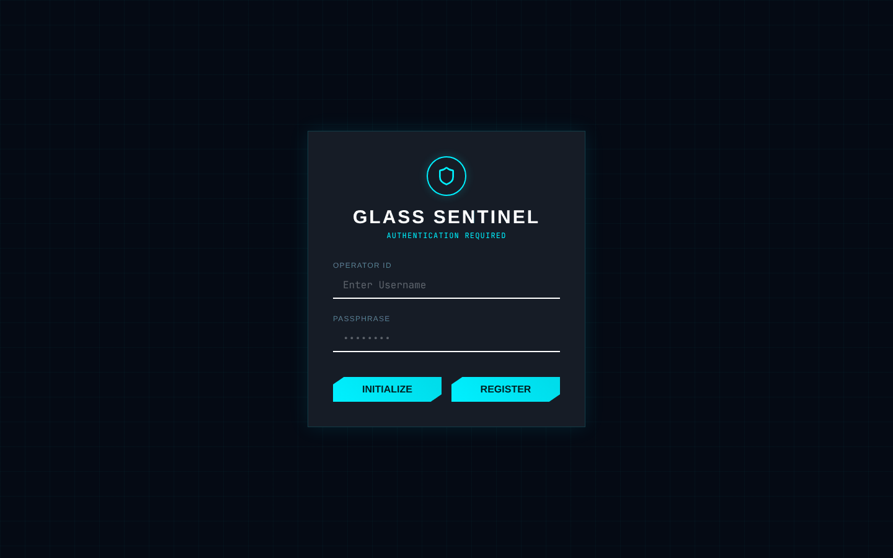
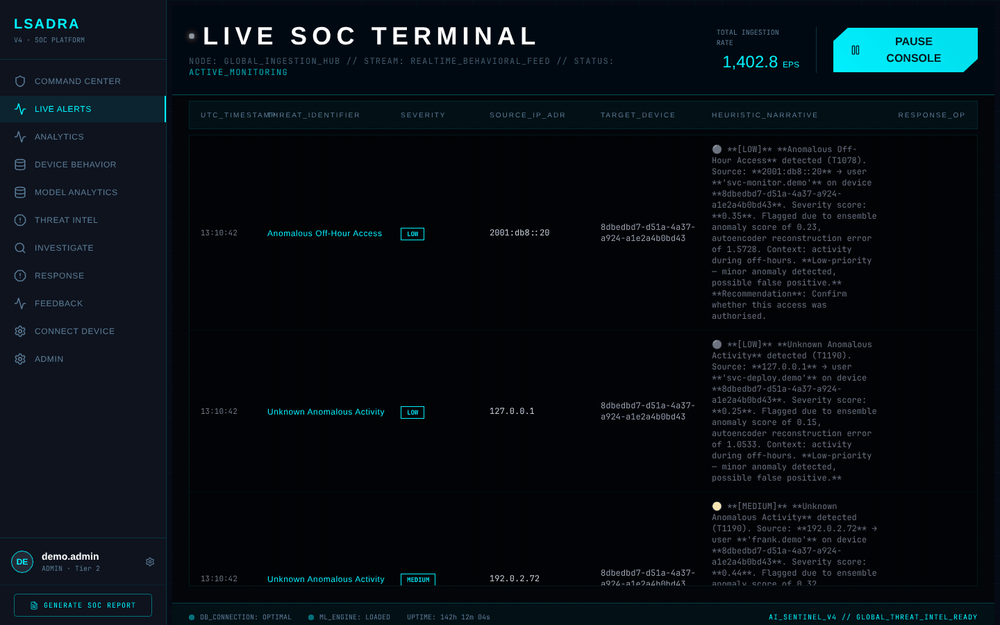
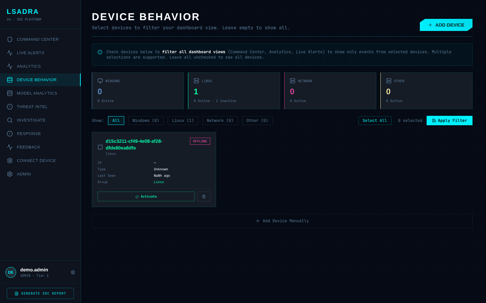
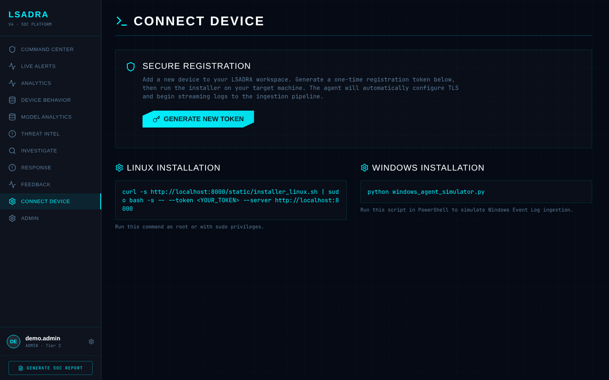
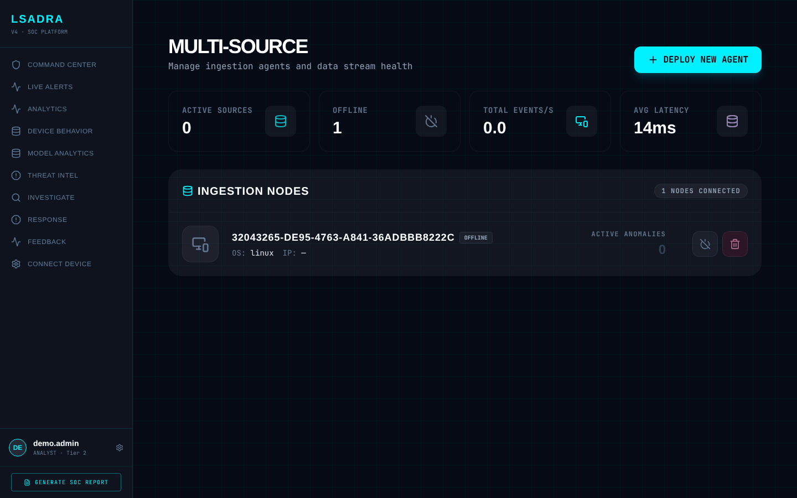
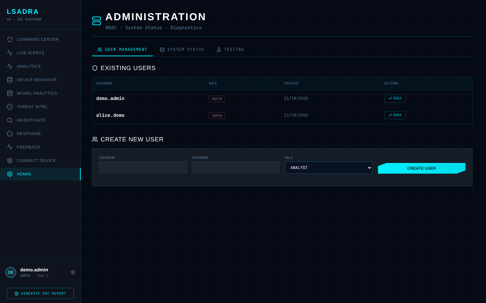
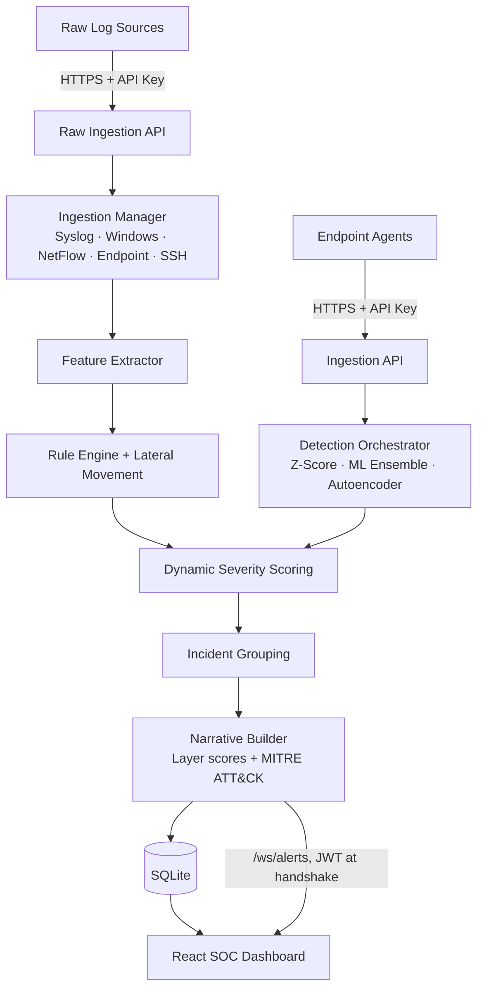

<div align="center">

# 🛡️ LSADRA

### Local Security Anomaly Detection & Risk Assessment: open source, explainable, built to run anywhere.

**Real-time, multi-source log detection with ML ensembles, rule-based ATT&CK mapping, and human-readable threat narratives. No LLM API keys required.**

<br/>

[](LICENSE)
[](https://www.python.org/)
[](https://fastapi.tiangolo.com/)
[](frontend/)
[](tests/test_v4_smoke.py)
[](tests/security/)
[](https://github.com/tsmanral/lsadra/actions/workflows/ci.yml)
[](https://scorecard.dev/viewer/?uri=github.com/tsmanral/lsadra)
[](https://github.com/tsmanral/lsadra/stargazers)

<br/>


<sub>The Command Center after replaying the bundled synthetic demo corpus. Every screenshot in this README is the real dashboard running against a local API.</sub>

</div>

---

## Contents

- [Why LSADRA?](#why-lsadra)
- [Quick start (local, about 10 minutes)](#quick-start-local-about-10-minutes)
- [Dashboard tour](#dashboard-tour)
- [Connect a real device](#connect-a-real-device)
- [Desktop app (preview)](#desktop-app-preview)
- [Run with Docker](#run-with-docker)
- [Configuration](#configuration)
- [Testing](#testing)
- [Benchmarks](#benchmarks)
- [Ingesting logs](#ingesting-logs)
- [Detection rules](#detection-rules)
- [Live alert stream (WebSocket)](#live-alert-stream-websocket)
- [Investigating incidents](#investigating-incidents)
- [Model integrity and training](#model-integrity-and-training)
- [LLM guardrails](#llm-guardrails-before-the-llm-ships)
- [Architecture](#architecture)
- [Project structure](#project-structure)
- [Contributing](#contributing)
- [Security](#security)
- [Project status](#project-status)

## Why LSADRA?

Enterprise SIEMs like Splunk and Microsoft Sentinel are powerful, and they are also heavy, expensive and opaque. Lightweight consumer tools watch the network but have no real detection intelligence. **LSADRA fills the gap**: a self-hostable SOC platform for individuals and small teams that explains *why* every alert fired.

- 🧠 **Multi-layer ML detection.** Statistical baselining (Z-score), an ensemble (Isolation Forest, LOF, One-Class SVM), and a PyTorch autoencoder, with drift tracking via Population Stability Index.
- 🔍 **Explainable by design.** Every alert says which detection layers fired and how strongly (z-score, ensemble score, reconstruction error), with a composite severity score broken down in plain English and a MITRE ATT&CK technique when a detection rule matched. Per-feature SHAP attribution is not in the live pipeline yet; it is planned for the supervised model in the detection roadmap.
- 🌐 **Multi-source ingestion.** Parsers for SSH auth logs, Syslog, Windows Events, network flows (NetFlow / firewall) and endpoint telemetry, through a structured-event API and a raw-log API.
- 📖 **Threat narratives without an LLM.** A template case-file generator turns correlated anomalies into readable incident stories. Zero API keys, zero recurring cost.
- 🚨 **Detection rules that matter.** 18 rules on the live path (brute force, credential stuffing, success after failures, port scans, large transfers, LOLBin abuse, encoded PowerShell, new services, scheduled tasks, cron and registry autostarts, cleared event logs) plus a scheduled lateral-movement scan, each with an ID, version, level and ATT&CK v20 technique and tactic, its own tests, and a committed [scorecard](docs/detection/scorecard.md). An alert names an ATT&CK technique only when a rule matched; an anomaly the ML layers raise without a matching rule is shown as *Unknown Anomalous Activity* with no technique. A Sigma layer (67 SigmaHQ and LSADRA rules, including a password-spraying correlation) runs alongside them in shadow mode.
- 📊 **SOC dashboard.** A React (Vite + TypeScript) command center with live alerts over an authenticated WebSocket, analytics, entity investigation, threat intel (a signed, key-free CISA KEV and MITRE ATT&CK bundle, optional IP feeds and local geolocation), device and model views, and JWT auth with roles. A legacy Streamlit interface is also included.

## Quick start (local, about 10 minutes)

This runs the API and the React dashboard on your own machine, then fills them with a labeled synthetic demo corpus so there is something to look at. Every command below was run end to end for this README.

**Prefer a container?** Open the repository in VS Code with "Reopen in Container" (or a Codespace opened in VS Code desktop). [`.devcontainer/`](.devcontainer/) installs Python 3.12, Node 24 and every dependency, sets dev mode and the CORS origin for you, runs the smoke test, and prints the commands for steps 2 to 4 below. The dashboard calls the API at `http://localhost:8000`, so a browser-only Codespace can't reach it yet.

### Prerequisites

| Tool | Version | Check |
| --- | --- | --- |
| Python | **3.12** or newer (CI runs 3.12 on Ubuntu, Windows and macOS, plus 3.13 and 3.14 on Ubuntu) | `python3.12 --version`, or `py -0` on Windows |
| Node.js + npm | 20 or newer (22 is used for the screenshots) | `node -v` |
| Git | any recent | `git --version` |

### 1. Clone and install the backend

```bash
git clone https://github.com/tsmanral/lsadra.git
cd lsadra
python3.12 -m venv venv                        # Windows: py -3.12 -m venv venv
venv/bin/pip install -r requirements.txt      # Windows: venv\Scripts\pip install -r requirements.txt
# Optional: CPU PyTorch for the autoencoder layer (the server runs without it)
venv/bin/pip install --no-deps -r requirements/torch.txt
```

Every dependency is pinned and hash-checked ([`requirements/README.md`](requirements/README.md)); `requirements.txt` installs everything except PyTorch, and `requirements/base.txt` alone is enough for the API server. PyTorch (CPU build, a few hundred MB from the PyTorch index) is optional: without it the server still starts and the autoencoder layer becomes a no-op, while the statistical and ensemble layers keep working.

### 2. Start the API in dev mode

The server refuses to start without a JWT secret unless dev mode is on, and the browser dashboard is only allowed to call the API from origins listed in `LSADRA_CORS_ORIGINS`. For a local run, set both:

```bash
# Linux / macOS
LSADRA_DEV_MODE=true LSADRA_CORS_ORIGINS=http://localhost:5173 \
  venv/bin/python -m lsadra.serve
```

```powershell
# Windows PowerShell
$env:LSADRA_DEV_MODE = "true"
$env:LSADRA_CORS_ORIGINS = "http://localhost:5173"
venv\Scripts\python -m lsadra.serve
```

`lsadra.serve` listens on `127.0.0.1:8000` (see [Network exposure and TLS](#network-exposure-and-tls) for other addresses). The database is created at `data/sentinel_v3.db` on first launch. Check it is up with `curl http://127.0.0.1:8000/api/health`. Interactive API docs are at http://127.0.0.1:8000/docs (dev mode only).

> **Dev mode is for your own machine only.** It uses a random JWT secret that changes on every restart (so you sign in again after a restart) and does not require TLS. See [Run with Docker](#run-with-docker) for a production setup.

### 3. Load the demo data

In a second terminal, from the repository root:

```bash
venv/bin/python scripts/seed_demo.py          # Windows: venv\Scripts\python scripts\seed_demo.py
```

This replays the 217 events in [`demo/corpus/`](demo/) through the real HTTP API, exactly like an agent would: it registers the user `demo.admin` (password `demo-only-not-a-secret`), enrolls a device, sends the events in batches and lets online detection run. It ends with `done — open the dashboard; alerts should be present.` All demo data is synthetic by construction: `demo-host-NN` hostnames, `*.demo` users and RFC 5737 / RFC 3849 documentation IP addresses.

### 4. Start the dashboard

In a third terminal:

```bash
cd frontend
npm ci
npm run dev
```

Open **http://localhost:5173** and sign in as `demo.admin` / `demo-only-not-a-secret` (the sign-in button is labelled **Initialize**). You can also create your own account with **Register**.

The dashboard only ever shows data from the API. Front-end developers who want canned data without a backend can run `VITE_DEMO_MOCKS=true npm run dev` and sign in as `testuser`; that switch exists only in the dev server and is compiled out of production builds.

### 5. Create an admin

Accounts created with **Register**, including `demo.admin`, get the `ANALYST` role, which sees only its own data and cannot open the **Admin** page. **Register** works here because dev mode turns self-service sign-up on; outside dev mode it is off unless you set `LSADRA_ALLOW_SIGNUP=true`. Admins are made from a shell on the server, with the same settings as the API (here, dev mode); without them the command stops with a message naming `LSADRA_JWT_SECRET` and `LSADRA_DEV_MODE`:

```bash
# Linux / macOS: promote the demo account, or create a new admin (prompts for a password of 12+ characters)
LSADRA_DEV_MODE=true venv/bin/python -m lsadra.admin_cli promote --username demo.admin
LSADRA_DEV_MODE=true venv/bin/python -m lsadra.admin_cli create-admin --username alice
```

```powershell
# Windows PowerShell (in a shell where $env:LSADRA_DEV_MODE = "true" is already set)
venv\Scripts\python -m lsadra.admin_cli promote --username demo.admin
```

Sign out and back in for the new role to apply. After that, admins create accounts and change roles from the **Admin** page, or with `POST /api/dashboard/users` (`{"username", "password", "role"}`, password 12+ characters, role `ADMIN`, `ANALYST` or `VIEWER`). For scripts and containers, `create-admin --password-stdin` reads the password from standard input instead of prompting.

> The dashboard calls the API at `http://localhost:8000`, which is set in [`frontend/src/services/api.ts`](frontend/src/services/api.ts). If you run the API elsewhere, change it there and add the dashboard's origin to `LSADRA_CORS_ORIGINS`.

### 6. Check everything works

```bash
venv/bin/python tests/test_v4_smoke.py        # expected: 27/27 passed
```

## Dashboard tour

The screenshots below were taken by following the quick start above, signed in as `demo.admin` after promoting it to admin, with the demo corpus replayed (plus a second replay of its benign background scenario from another device), in a 1440×900 window. `ADMIN` sees every user's data; `ANALYST` and `VIEWER` see only their own.

### Sign in



Sign-in goes only through `POST /api/auth/login`; there is no offline login, so if the API is unreachable, sign-in fails.

### Command Center


The home screen. The tiles at the top count events in the last 24 hours, active threats, open and closed incidents, and devices currently sending. **Ingestion Health** shows the measured event rate over the last minute; latency and drop rate say "not measured" until the API measures them. **Top Active Incidents** lists open incidents by recency with their severity, source IP and attack type. The **Live Threat Feed** on the right is pushed over the `/ws/alerts` WebSocket as detection stores each anomaly. If the socket drops, the page reconnects with backoff and polls every 5 seconds in the meantime.

### Live Alerts



A full-width stream of every alert with its MITRE technique, source IP, target device and the generated narrative that explains why it fired: the statistical deviation (σ), the ensemble score, and context such as off-hours activity or multiple usernames targeted. **Pause console** freezes the stream while you read.

### Analytics


Incident timeline by severity, severity distribution, and event and anomaly volume. The severity and time-range filters at the top apply to every chart, and **SOC Report** exports a PDF report.

### Device Behavior



Every enrolled device grouped by platform, with its status. Select devices and **Apply Filter** to scope the Command Center, Analytics and Live Alerts to just those devices.

### Model Analytics


The model registry: which detection models are trained, on how many events, and when. A trained model replaces the live one only if it passes the canary check in [Model integrity and training](#model-integrity-and-training). On the demo data alone the first candidate fails that check, so the registry stays empty, as shown here; detection still runs, and its rules raise the alerts shown on the other pages. Further down are feature drift (PSI), which the scheduler computes daily and you can trigger by hand, and a summary of the detection pipeline.

### Connect Device



Generates a one-time registration token and the one-line Linux install command for it. See [Connect a real device](#connect-a-real-device).

### Sources



Per-source ingestion health: which log sources are active, events per second and latency, and the ingestion nodes (devices) behind them.

### Admin



Admins only. List users, change their roles, and create accounts with a chosen role.

### Pages that still show placeholder data

Incident drill-down, Investigate, Response, Feedback, Live Alerts, Sources and Device Behavior read real data (see [Investigating incidents](#investigating-incidents)). Two screens still show fixed content in places. They are good first contributions:

| Page | What is still placeholder |
| --- | --- |
| Threat Intel | The lookup box does not call the API yet, so it returns nothing; the server-side AbuseIPDB cache (`LSADRA_ABUSEIPDB_API_KEY`) is not shown here |
| Analytics | The event and anomaly timeline spreads the 24-hour totals evenly across the hours |

## Connect a real device

**Linux.** Open **Connect Device**, click **Generate new token**, and copy the command it shows to the host you want to monitor. It looks like this, with the token and hashes filled in:

```bash
curl -fsSLo lsadra-install.sh https://<your-server>/static/installer_linux.sh \
  && echo '<installer-sha256>  lsadra-install.sh' | sha256sum -c - \
  && sudo bash lsadra-install.sh --token <TOKEN> --server https://<your-server> --agent-sha256 <agent-sha256>
```

The command saves the installer to a file and checks its SHA-256 before running it with `sudo`; the installer then checks the agent's SHA-256 before installing it as a systemd service, and picks `/var/log/auth.log` or `journalctl` automatically. Tokens are single-use. The installer refuses a plain-HTTP server unless `--allow-insecure-http` is added, which the page does (with a warning) when the API is on `http://`; use that only on a trusted local network, because the agent sends its API key on every request.

**Windows (test agent).** `python windows_agent_simulator.py` starts a local API, registers a simulated Windows device and streams events from a dummy log file. `windows_live_agent.py` reads the live Windows event log.

**Anything else.** Send events straight to the [ingestion API](#ingesting-logs).

## Desktop app (preview)

`desktop/` holds a small Tauri tray app (about 2 MB installed) that starts the LSADRA server on `127.0.0.1`, shows the dashboard in a native window, and keeps running in the system tray when the window is closed. It generates a per-install JWT secret, so no dev mode is needed. Sign-up is off, so create your admin account first as in step 5 above (`LSADRA_DEV_MODE=true` is fine for that one command, since it only writes to the database). For now it runs the server from a source checkout set up as in step 1 of the quick start; a self-contained server bundle comes later.

```bash
cd frontend && npm ci && npm run build && cd ..
cd desktop && npm ci && npm run dev      # or: npm run build  (installers in src-tauri/target/release/bundle)
```

See [desktop/README.md](desktop/README.md) for settings (`LSADRA_HOME`, `LSADRA_PYTHON`, port) and how it finds the server.

## Run with Docker

The Compose stack runs the API (`127.0.0.1:8000`), the React dashboard (**http://localhost:8080**, change with `WEB_PORT`) and an idle agent simulator. Both ports are published on the host's loopback only. The legacy Streamlit dashboard is off by default; `docker compose -f docker-compose.yml --profile legacy up -d` starts it on `127.0.0.1:8501`.

```bash
cp .env.example .env
# Edit .env: set LSADRA_JWT_SECRET to your own random value of at least 32 bytes, e.g. the output of
#   python -c "import secrets; print(secrets.token_urlsafe(48))"
docker compose -f docker-compose.yml up -d --build
docker compose -f docker-compose.yml exec api python -m lsadra.admin_cli create-admin --username alice
```

Outside dev mode the server refuses to start with a JWT secret shorter than 32 bytes or a documented placeholder, and self-service sign-up is off, so create the first admin as above and add other accounts from the **Admin** page. The dashboard calls the API at `http://localhost:8000` from your browser, so open it on the machine running Docker; if you change the dashboard's port or address, set `LSADRA_CORS_ORIGINS` to match.

Name `docker-compose.yml` explicitly as above. A plain `docker compose up` also loads [`docker-compose.override.yml`](docker-compose.override.yml), the development override: it mounts the source tree, turns on hot reload and forces TLS off.

`.env.example` sets `LSADRA_REQUIRE_TLS=false` so a first run works over plain HTTP on loopback. To reach the API from other machines, put it behind HTTPS (set `LSADRA_REQUIRE_TLS=true` and list your proxy in `LSADRA_TRUSTED_PROXY_IPS`) or give it a certificate, as described below. The image builds in two stages from a digest-pinned `python:3.12-slim`, installs only hash-checked dependencies, and runs as an unprivileged user (uid 10001) that can write only `/app/data` and `/app/logs`.

A versioned image is published to [GHCR](https://github.com/tsmanral/lsadra/pkgs/container/lsadra) on every release, only after the full CI suite passes on the tagged commit. Each image carries an SBOM and SLSA provenance, a GitHub attestation and a keyless Sigstore signature. Verify one before you run it:

```bash
gh attestation verify oci://ghcr.io/tsmanral/lsadra:<version> --owner tsmanral
cosign verify ghcr.io/tsmanral/lsadra:<version> \
  --certificate-identity-regexp '^https://github.com/tsmanral/lsadra/.github/workflows/release.yml@refs/tags/v' \
  --certificate-oidc-issuer https://token.actions.githubusercontent.com
```

### Network exposure and TLS

The API listens on **127.0.0.1** unless you set `LSADRA_API_HOST`. On any other address it refuses to serve plain HTTP: it uses `LSADRA_TLS_CERT` / `LSADRA_TLS_KEY` if set, assumes TLS ends at a proxy if `LSADRA_TRUSTED_PROXY_IPS` is set, and otherwise generates a self-signed certificate in `data/tls/` on first boot. The certificate's SHA-256 fingerprint is printed at start-up, served at `GET /api/server/identity`, and shown on **Connect Device** next to the registration token. Put it in the agent config as `server_cert_sha256` (Linux agent) or `LSADRA_SERVER_CERT_SHA256` (Windows agent) and the agent talks only to that certificate. `LSADRA_ALLOW_PLAINTEXT_LISTENER=true` is an explicit, logged exception (docker compose sets it because it publishes the port on loopback only). Start the server with `python -m lsadra.serve` (or `python server.py`) so this policy applies; plain `uvicorn` skips it.

### Accounts, sessions and audit

- **Sessions** last 60 minutes (`LSADRA_JWT_EXPIRATION_MINUTES`). Logging out (`POST /api/auth/logout`), changing a password or role, or disabling an account ends every earlier session at once.
- **Passwords** need 12+ characters (`LSADRA_MIN_PASSWORD_LENGTH`) and may not be on the bundled common-password list. After 5 failed logins for one username, or 20 from one IP, in 15 minutes, logins answer `429` with `Retry-After` (`LSADRA_LOGIN_MAX_FAILURES_PER_USER`, `LSADRA_LOGIN_MAX_FAILURES_PER_IP`, `LSADRA_LOGIN_FAILURE_WINDOW_SECONDS`).
- **Authenticator (TOTP)** is optional per account (`POST /api/auth/totp/setup`, then `/enable` with a code). On the server, `python -m lsadra.security.totp_cli enroll <username>` enrols one. `LSADRA_ADMIN_TOTP=required` stops admins logging in without one.
- **Devices** can be revoked (`POST /api/devices/{id}/revoke`) or given a new key (`POST /api/devices/{id}/rotate-key`); the old key keeps working for `LSADRA_DEVICE_KEY_ROTATION_OVERLAP_MINUTES` (10).
- **Audit trail:** logins, lockouts, logouts, password, role, TOTP and account changes, device revokes and key rotations, backups and restores go to a hash-chained `audit_events` table (`GET /api/dashboard/audit`, `GET /api/dashboard/audit/verify`, admin only; kept at least 365 days). Lockouts, admin grants and a broken chain also raise LSADRA alerts.
- **API docs** (`/docs`, `/openapi.json`) are served in dev mode only (`LSADRA_EXPOSE_API_DOCS`).

### Data at rest and backups

At start-up the server restricts `data/` to its own account (0700 / 0600; `LSADRA_RESTRICT_DATA_PERMISSIONS`). Retention is tiered. Raw events, heartbeats, IP intelligence and geolocation rows, and old registration tokens are kept `LSADRA_RETENTION_DAYS` (default 30). Alerts, closed incidents, analyst feedback and rollups are kept `LSADRA_ALERT_RETENTION_DAYS` (default 365, never less than the raw window), and the events behind a kept alert stay with it. Deleted rows are overwritten in the database file. What is stored, and for how long, is listed in [docs/security/data-inventory.md](docs/security/data-inventory.md).

```bash
python -m lsadra.backup create                 # online copy + SHA-256 manifest, in data/backups/
python -m lsadra.backup verify data/backups/lsadra-<time>.db
python -m lsadra.backup restore data/backups/lsadra-<time>.db --yes   # stop the server first
```

## Configuration

All settings are environment variables; [`.env.example`](.env.example) lists every one with a comment. The server reads them from the process environment and does not load `.env` itself (Docker Compose does). The ones you are most likely to need:

| Variable | Default | What it does |
| --- | --- | --- |
| `LSADRA_DEV_MODE` | `false` | Local development only: per-boot JWT secret, TLS optional |
| `LSADRA_JWT_SECRET` | none | Required outside dev mode: your own random value of at least 32 bytes |
| `LSADRA_ALLOW_SIGNUP` | `false` (on in dev mode) | Lets anyone who reaches the API create an `ANALYST` account with **Register** |
| `LSADRA_CORS_ORIGINS` | empty (Compose: `http://localhost:8080`) | Comma-separated browser origins allowed to call the API, e.g. `http://localhost:5173` |
| `LSADRA_REQUIRE_TLS` | `true` (`false` in dev mode) | Reject plain-HTTP requests |
| `LSADRA_TRUSTED_PROXY_IPS` | empty | Reverse proxies whose `X-Forwarded-Proto` is trusted |
| `LSADRA_API_HOST` / `LSADRA_API_PORT` | `127.0.0.1` / `8000` | Where `python -m lsadra.serve` listens; any non-loopback host needs TLS |
| `LSADRA_ADMIN_TOTP` | `optional` | `required` stops admins signing in without an authenticator |
| `LSADRA_ABUSEIPDB_API_KEY` | empty | Enables IP reputation lookups on Threat Intel |
| `LSADRA_GEO_RESOLUTION_ENABLED` | `false` | Opt-in IP geolocation from a local `.mmdb` file (no IP leaves the machine; see [Threat Intelligence](#threat-intelligence)) |
| `LSADRA_RETENTION_DAYS` | `30` | How long raw events are kept |
| `LSADRA_ALERT_RETENTION_DAYS` | `365` | How long alerts, closed incidents and rollups are kept (never less than the raw window) |
| `LSADRA_SCHEDULER_ENABLED` | `true` | Background jobs: retention, metrics, correlation, drift, device health |
| `LSADRA_MIN_BASELINE_EVENTS` | `200` | Events a device needs before its baseline is trusted |

## Testing

CI runs these on every pull request across Ubuntu, Windows and macOS. Run them before you open one. CI sets `LSADRA_DEV_MODE=true` for the test steps, and so should you if the shell has no `LSADRA_JWT_SECRET`.

| What | Command | Expected | Time |
| --- | --- | --- | --- |
| Smoke gate | `python tests/test_v4_smoke.py` | `27/27 passed` | seconds |
| Security regression gate | `python -m pytest tests/security/ -q` | 0 failures | ~10 s |
| Full backend suite | `python -m pytest tests/ --ignore=tests/test_v4_smoke.py -q` | 0 failures | ~1 min |
| Lint | `ruff check .` (ruff comes with `requirements.txt`) | `All checks passed!` | seconds |
| Dashboard type check + build | `cd frontend && npm ci && npm run build` | `✓ built` | ~1 min |
| Dashboard lint | `cd frontend && npm run lint` | CI fails only if errors exceed the recorded baseline | seconds |

Use the `python` from your virtual environment (`venv/bin/python`, or `venv\Scripts\python` on Windows). Tests use their own temporary databases and never touch `data/`.

## Benchmarks

[`benchmarks/`](benchmarks/) drives the real API at rising event rates and records sustained events/s, request latency percentiles, event-loop lag and memory. Each run gets a fresh temporary database and model store.

```bash
# 30-second sanity check
python benchmarks/run_ingest_bench.py --detection off --devices 1 --rates 50 \
    --duration 5 --min-requests 1 --repeats 1 --output /tmp/check.json

# Full baseline, about 25 minutes; run on an otherwise idle machine
python benchmarks/run_ingest_bench.py
```

The sanity check prints a line such as `devices=1 offered=50 sustained=50 p50/p95/p99=29.71/42.27/43.38ms` and writes the full result as JSON. Method, committed baselines and how to compare runs are in [`benchmarks/README.md`](benchmarks/README.md). `scripts/seed_demo.py --rate 500 --duration 30 --devices 10` is the same load driver on its own, against a server you started.

## Ingesting logs

Both ingestion endpoints authenticate the device with `X-Device-Id` / `X-Api-Key` (issued at device registration) and accept up to 100 items per request.

**Structured events.** Collectors that already normalize send events that conform to the frozen [event schema v1](docs/contracts/event-schema.v1.json):

```bash
curl -X POST http://localhost:8000/api/events/batch \
  -H "Content-Type: application/json" \
  -H "X-Device-Id: <device-id>" -H "X-Api-Key: <api-key>" \
  -d '{"events": [{"schema_version": "1", "timestamp": "2026-01-15T02:01:12Z", "event_type": "auth_failure",
                   "host": "demo-host-01", "effective_username": "alice.demo", "source_ip": "192.0.2.45"}]}'
```

`schema_version` (`"1"`), `timestamp` (RFC 3339 with offset) and `event_type` are required. Device and user identity come from the credentials, so `device_id`/`user_id` in an event, or any unknown field, are rejected. A contract violation returns `422` naming the field (e.g. `["body", "events", 0, "source_ip"]`) and nothing from that batch is stored. Full rules and the compatibility policy: [docs/contracts](docs/contracts/README.md).

**Raw lines.** Any log line from any supported source, parsed server-side:

```bash
curl -X POST http://localhost:8000/api/events/raw \
  -H "Content-Type: application/json" \
  -H "X-Device-Id: <device-id>" -H "X-Api-Key: <api-key>" \
  -d '{"lines": [{"raw_line": "Jan  5 12:34:56 demo-host-01 sudo[999]: root : COMMAND=/bin/bash", "source_hint": "syslog"}]}'
```

`source_hint` is optional and must be one of `ssh`, `syslog`, `windows`, `network`, `endpoint`; omit it to auto-detect. Lines no parser recognizes are counted in `parse_errors` rather than rejected.

Per-source ingestion health is available at `GET /api/events/stats`.

Agents report liveness with `POST /heartbeat` and read their settings with `GET /api/devices/config/{device_id}`. Both authenticate with the same `X-Device-Id` / `X-Api-Key` headers as ingestion, and a device can only report for, or read, itself.

**Posture checks.** The Linux agent also runs about ten read-only host checks once a day (SSH root login and password authentication, an active firewall, automatic updates, disk encryption, system logging, extra UID-0 accounts, `/etc/shadow` and `/etc/passwd` permissions), each tagged with the CIS Controls v8.1 IG1 safeguard it supports. Results arrive as `posture_check` events with `check_id`, `cis_safeguards`, `status` (`pass`, `fail`, `not_applicable`, `error`) and `detail` attributes. The checks only read files and run allow-listed status commands; they never change the host. Set `posture_interval_hours: 0` in the agent config to turn them off, or run `python3 posture.py` on a host to see the report locally. The checks live in [`lsadra/endpoint_agent/posture_checks_linux.yml`](lsadra/endpoint_agent/posture_checks_linux.yml); the agent needs `posture.py` and that file next to `linux_agent.py`.

## Detection rules

Rules live in one registry, [`lsadra/detection/rule_engine.py`](lsadra/detection/rule_engine.py), and the detection orchestrator runs every one of them on every scored event. What you get on each alert:

- **Rule attribution.** Each rule has a stable ID (for example `lsadra-auth-brute-force`), a version, a status and a [Sigma-style level](https://sigmahq.io/docs/basics/rules.html#level). Alerts store the rule ID and version (`anomalies.rule_id`, `rule_version`), so every alert traces back to one rule version.
- **When a rule alerts.** A `medium`, `high` or `critical` match raises an alert on its own and sets a severity floor. A `low` match (off-hours login, a lone LOLBin, a large transfer to an internal or documentation address) only names the technique of an event the anomaly layers already flagged. Activity from the same address in a second log source raises the level one step.
- **ATT&CK.** One map, pinned to MITRE ATT&CK Enterprise **20.1** ([`lsadra/detection/attack_map.py`](lsadra/detection/attack_map.py), table generated by `scripts/update_attack_data.py`). Alerts carry the technique and its tactics (`mitre_tactics`). CI fails if any rule, narrative or corpus label names a technique that is unknown, revoked or deprecated in that release.
- **Confidence.** `mitre_confidence` is the matched rule's author-set confidence that a match is that technique (0.4 to 0.9). It is `0` when no rule matched. It is not a model probability.
- **Time windows that span runs.** Rule windows (5, 10, 15 and 30 minutes) are computed over the new events plus the device's last 30 minutes of stored events, so an attack paced across several detection runs still crosses its threshold. Stored history is context only and is never alerted on twice.
- **Event types.** Detection uses a closed list of about 30 event types, each mapped to an OCSF 1.9 class and ECS 9.5 categories ([`lsadra/detection/event_types.py`](lsadra/detection/event_types.py)). The bundled parsers and agents emit these names; older names such as `ssh_failed_password` or `process_create` are mapped; anything else is stored but treated as `other`, which no rule matches. The ingestion contract is unchanged: `event_type` is still a free string in event schema v1.
- **Scorecard.** [`docs/detection/scorecard.md`](docs/detection/scorecard.md) scores every rule on the labelled demo corpus: today 3 of 3 attack scenarios detected and 0 alerts on the benign control set. It is regenerated with `python scripts/detection_scorecard.py`, and CI fails when it is stale or when the benign set raises an alert. It measures the rules only; the ML layers are measured separately.

To add a rule, register it with the `@rule(...)` decorator, add positive and negative cases to `tests/test_rules.py`, and regenerate the scorecard.

### Sigma rules (shadow mode)

A second rule layer runs standard [Sigma](https://sigmahq.io/) 2.0 rules in-process with [pySigma](https://github.com/SigmaHQ/pySigma): 56 rules from the SigmaHQ repository (Linux and Windows process, file, registry and Windows log rules, used unchanged under the Detection Rule License 1.1) and 11 LSADRA rules, including a correlation rule for password spraying (one address failing against 5 or more accounts in 10 minutes). The rules and their attribution are in [`lsadra/detection/sigma_rules/`](lsadra/detection/sigma_rules/README.md).

- **Shadow by default.** `LSADRA_SIGMA_MODE=shadow` runs the rules on every scored event and stores each match in the `sigma_matches` table and in the result's `sigma_matches` list, but never raises or relabels an alert. `alert` lets a `medium` or higher match raise an alert, with the Sigma rule's technique, when no built-in rule matched. `off` skips the layer. New detection layers start in shadow mode until the detection bench shows they help (ADR 0007).
- **Suppressions.** Reviewed exceptions are Sigma filters: bundled ones in `sigma_rules/filters/suppressions.yml`, site-specific ones in the file named by `LSADRA_SIGMA_SUPPRESSIONS`.
- **Scorecard.** The [scorecard](docs/detection/scorecard.md) has a Sigma section: today the layer matches all 3 attack scenarios and 0 of 99 benign events.
- Rules are code to pySigma (it compiles them to Python), so the layer loads only the bundled folder and the operator's suppression file.

## Live alert stream (WebSocket)

`/ws/alerts` is a WebSocket that pushes each anomaly to connected clients as soon as detection persists it. It authenticates at the handshake with the same JWT the dashboard uses for REST (`POST /api/auth/login`), and nothing is accepted before the token verifies. Browsers pass the token as a subprotocol; other clients can send an `Authorization: Bearer` header instead. Tokens in the query string are not read.

```js
const ws = new WebSocket("wss://lsadra.example/ws/alerts", ["bearer", token]);
ws.onmessage = (e) => console.log(JSON.parse(e.data)); // {"type":"ready",...} then {"type":"alert",...}
```

Scoping matches the REST API: an ADMIN receives every alert, other roles only their own. A missing, invalid or expired token, or plain `ws://` while TLS is required, is refused with close code `1008` (an HTTP `403` at the handshake). An open socket is closed with `1008` when its token expires, so the client reconnects with a fresh one. A client that stops reading is closed with `1013` once `LSADRA_WS_ALERT_QUEUE_SIZE` alerts (default 256) are waiting for it; it should reconnect and backfill from `GET /api/dashboard/anomalies`. The dashboard's Command Center and Live Alerts pages load recent alerts over REST, then add each pushed alert as it arrives. After any disconnect they reconnect with backoff (1 s doubling to 30 s) and backfill over REST, and while the socket is down the Command Center falls back to polling every 5 s. Incidents, KPIs and ingestion health still refresh over REST, every 10 s and shortly after each new alert.

## Threat Intelligence

Intel comes in two tiers ([ADR 0004](docs/architecture/adr/0004-intel-two-tier-licensing.md)). Nothing is simulated: when no source knows an IP, the dashboard says so.

- **Bundled (works out of the box, no key, no network).** `lsadra/intel/data/intel-YYYYMMDD.sqlite` ships the CISA Known Exploited Vulnerabilities catalog and MITRE ATT&CK Enterprise techniques. Its `manifest.json` records the file's SHA-256 and each source's version, and `manifest.sig` is an Ed25519 signature checked against `lsadra/intel/trusted_keys.json` before the file is opened (read-only). A bundle that fails verification, or lists a source outside the redistribution allowlist, is refused and the tier switches off. Licences are in [`lsadra/intel/data/LICENSES.md`](lsadra/intel/data/LICENSES.md). The `intel-bundle` workflow rebuilds it weekly and opens a pull request when upstream data changed.
- **Runtime (opt-in, stays on your machine).** A gitignored `data/intel_runtime.db` holds what you turn on: keyless IP lists via `LSADRA_INTEL_FEEDS` (`feodo` = abuse.ch Feodo Tracker C2s, `spamhaus_drop` = Spamhaus DROP, `tor_exits` = Tor exit nodes), fetched with conditional GETs every `LSADRA_INTEL_FEED_REFRESH_HOURS`; and AbuseIPDB lookups when `LSADRA_ABUSEIPDB_API_KEY` is set (analysts and admins choose per lookup, since it sends the IP to AbuseIPDB). A fresh install makes no intel requests at all.
- **Local geolocation.** IPs are geolocated from a `.mmdb` file on disk; no IP is sent to a geolocation service. `python -m lsadra.intel geo-update` downloads GeoLite2-City when `LSADRA_MAXMIND_ACCOUNT_ID` and `LSADRA_MAXMIND_LICENSE_KEY` are set (free MaxMind account), otherwise the keyless DB-IP City Lite database (CC BY 4.0), into `data/geo/`. Or point `LSADRA_GEOIP_DB` at your own file.

```bash
python -m lsadra.intel status         # bundle signature, feed counts, geo database
python -m lsadra.intel update-feeds   # fetch the feeds in LSADRA_INTEL_FEEDS now
python -m lsadra.intel geo-update     # download a local geolocation database
```

API (JWT, any role unless noted): `GET /api/intel/status`, `GET /api/intel/ip/{ip}` (`?remote=true` asks AbuseIPDB; analysts and admins only), `GET /api/intel/cve/{cve}`, `GET /api/intel/kev?q=`, `GET /api/intel/technique/{id}`, `GET /api/intel/flagged-ips` (public IPs from your anomalies; admins see all), `POST /api/intel/feeds/refresh` (admin).

## Investigating incidents

Every investigation page in the dashboard reads real data from these endpoints. An ADMIN sees everything; other roles see only data from their own devices, and anything else answers `404`.

| Endpoint | Used by | Returns |
|---|---|---|
| `GET /api/incidents/{id}` | Incident drill-down, Response | The incident, every alert in it oldest first (narrative, MITRE technique, raw log line), the IPs, users and hosts involved, and its response playbook. |
| `GET /api/entity?q=...` | Investigate | Profile of an IP, user name or host: risk (highest alert severity, 0 to 100), alerts, related incidents and entities, latest raw events. An incident id (`12`, `inc_12`, `INC-12`) resolves to that incident. Nothing on record is a `404`, never a made-up profile. |
| `GET /api/feedback` | Feedback | Analyst labels with totals and the share confirmed as real threats. |
| `POST /api/feedback` | Feedback, drill-down | Labels one alert `true_positive` or `false_positive` with a note (ADMIN or ANALYST). |

Playbooks are guidance: LSADRA does not run their commands. Commands use placeholders such as `<SOURCE_IP>` and `<USERNAME>` that the analyst fills in, and are never filled in from log text, which an attacker controls. Narratives render as a small, link-free markdown subset in the dashboard.

## Model integrity and training

Model files are never trusted just because they sit in `data/models/`. Every file the detection stack writes (the scikit-learn ensemble, the autoencoder weights, per-entity baselines, drift reference, model cards) is listed with its SHA-256 in `data/models/manifest.json`, and the manifest carries an HMAC keyed by `LSADRA_MODEL_SIGNING_KEY` (default: a key derived from `LSADRA_JWT_SECRET`). A file is deserialized only after its bytes match an authenticated entry; autoencoder weights additionally load with `weights_only=True`. Anything that does not verify is ignored and the models retrain. Rotating the signing key (or the JWT secret it is derived from) therefore triggers a retrain.

Training is gated:

- **Clean data.** Training uses the most recent `LSADRA_TRAINING_MAX_EVENTS` events (default 10,000) from all devices, minus events recorded as anomalies and events inside an open or investigating incident. With two or more devices, none supplies more than `LSADRA_TRAINING_MAX_DEVICE_SHARE` of the set (default 0.5). At least `LSADRA_MIN_TRAINING_EVENTS` usable events are needed (default 50).
- **Canary before promotion.** A candidate is trained beside the live models and replayed against the attack scenarios of the demo corpus (`LSADRA_CANARY_SCENARIOS`, default `ssh_bruteforce,injection_attempts`). It replaces the live models only if its ML layers still flag at least `LSADRA_CANARY_MIN_RECALL` (default 0.5) of each scenario's attack events; otherwise it is discarded. Poisoned training data typically fails here. Setting the recall to 0 turns the gate off (not recommended).
- **One run at a time, ADMIN only.** `POST /admin/retrain` (background) and `POST /api/dashboard/retrain` (waits for the result) answer `409` while a run is in progress and `429` with `Retry-After` within `LSADRA_RETRAIN_COOLDOWN_SECONDS` (default 600) of the last run. Automatic training after a device leaves baselining goes through the same gate.
- **Rollback.** The files being replaced are kept in `data/models/previous/`; `POST /api/models/rollback` (ADMIN) swaps them back, and running it again undoes the rollback.
- **Audit trail and model cards.** Every attempt (promoted, rejected, skipped, refused, rolled back) is a row in `model_training_runs`. Each promoted model gets a JSON model card: type, file hash, features, training window and event counts, exclusions, canary result and library versions.

Per-entity baselines are saved as plain JSON and survive restarts. Drift is measured daily (and on `POST /api/dashboard/run-drift`): the last `LSADRA_DRIFT_WINDOW_HOURS` of events (default 24) are compared by PSI against quantiles stored at training time; a drifted feature marks the models stale and logs a warning that the cause may be poisoned training data. `GET /api/models/status` (ADMIN, ANALYST) reports model cards, baseline coverage, the latest drift per feature and recent training runs.

## LLM guardrails (before the LLM ships)

The optional LLM tier (M4, [ADR 0007](docs/architecture/adr/)) will triage incidents and recommend next steps; it is never on the detection path and never acts. Its controls are in place first, in `lsadra/llm/`:

- **Fixed output.** The model must return JSON matching `TRIAGE_SCHEMA` (summary, verdict, confidence, cited event ids, up to five recommended actions from a closed list). The runtime enforces it as a grammar and LSADRA validates it again: no extra keys, every cited event id must belong to the incident, every action target must be a host, user or IP from that evidence, and no URLs, links, HTML or tool calls anywhere. Anything else is discarded and the deterministic narrative is shown.
- **Spotlighting.** Log-derived text is cleaned and placed only inside a data block fenced by a random per-request delimiter that never occurs in the data.
- **Recommend-only.** The action broker can only store recommendations as `PROPOSED` actions (`proposed_actions` table); an ADMIN approves or rejects them, and approval executes nothing.
- **Local by default.** A bring-your-own-model endpoint must be on this machine (loopback or `localhost`) unless `LSADRA_LLM_ALLOW_REMOTE=true`, and a remote one must use HTTPS. Downloaded GGUF/ONNX weights load only if their SHA-256 matches a pin in `lsadra/llm/pinned_models.json` or `LSADRA_LLM_MODEL_SHA256`.
- **Red-team corpus.** [`demo/llm_redteam/`](demo/llm_redteam/) holds synthetic injection payloads with deterministic scorers. CI runs them offline on every PR; `python scripts/llm_redteam.py --endpoint http://127.0.0.1:8080` runs them against a local `llama-server`. Add payloads by PR.

## Architecture



A deeper technical walkthrough lives in [ARCHITECTURE.md](ARCHITECTURE.md), C4 context, container and component diagrams are in [docs/architecture/c4.md](docs/architecture/c4.md), and the platform's design evolution is documented in [docs/V3_VS_V4_EVOLUTION.md](docs/V3_VS_V4_EVOLUTION.md).

Ingestion never runs detection inside the request: the handler stores the batch and enqueues the device on a bounded, per-device-coalescing queue drained by a single detection worker on its own thread (`LSADRA_DETECTION_QUEUE_SIZE`, default 256 devices; when it is full, ingestion answers `503` with `Retry-After` and stores nothing, so agent retries never duplicate events). API handlers never wait on SQLite or bcrypt on the event loop either: each one runs its storage and hashing work in the server's thread pool, so a slow write cannot stall other requests. A device key that has passed bcrypt is not re-hashed on every batch: a short-lived, size-bounded cache remembers the verification (as a keyed fingerprint, never the key) for `LSADRA_DEVICE_AUTH_CACHE_TTL_SECONDS`, default 60 s, bound to the stored hash, so re-keying or deleting a device still takes effect on the next request. Once an entry is past half its TTL, the next batch from that device queues a background bcrypt re-verify that renews it, so a device that sends steadily never waits on bcrypt after its first batch. Detection itself is CPU-bound Python on that worker thread, so the server shortens Python's thread switch interval at startup (`LSADRA_THREAD_SWITCH_INTERVAL_MS`, default 0.5 ms, against CPython's 5 ms), so a detection run hands the GIL back to waiting ingestion requests sooner.

Background jobs (APScheduler) handle cross-source correlation, lateral-movement scans, metrics pre-aggregation, local geo-resolution, runtime intel feed refresh, drift detection and data retention. No external queue or cron is required.

**Today** the stack is Python end to end: a FastAPI core (ingestion, detection, storage, orchestration), a React + Vite SOC dashboard, and a thin Python endpoint agent.

**In progress:** the endpoint agent is being replaced by **Rust collectors** in [`collectors/`](collectors/): small static binaries that read the OS log source (journald on Linux, the Windows Event Log on Windows), check every event against the contract, spool it to disk and ship it over HTTPS, so an outage or a restart loses nothing. The first build is about 2 MB on disk and under 4 MB RSS; see [`collectors/README.md`](collectors/README.md). The Python core keeps the ML and explainability work, where its ecosystem is the reason to stay. The two sides are bound by a versioned contract, [`docs/contracts/event-schema.v1.json`](docs/contracts/event-schema.v1.json), rather than shared code. See [ADR 0001](docs/architecture/adr/0001-rust-collector-split.md) for the reasoning. Until the Rust agent ships, the Python Linux agent remains the stopgap: it tails the files listed in `log_paths` in its config (or journald when none is set), sends at most 100 events per batch, drops a batch the core rejects as invalid instead of re-sending it, and waits out `Retry-After` on `429`/`503`.

## Project structure

```
lsadra/             Core platform: auth, ingestion, detection, storage, scheduler, legacy UI, admin CLI (admin_cli.py)
  intel/            Two-tier threat intel: signed bundle (data/), runtime feeds, local geolocation, CLI
  detection/sigma_rules/  Sigma rules: sigmahq/ (DRL 1.1, unmodified), lsadra/, filters/ (suppressions)
collectors/         Rust endpoint collectors (Cargo workspace): core (schema check, spool, shipper, key store), journald and Windows Event Log sources, lsadra-agent binary
frontend/           React (Vite + TypeScript) SOC dashboard; Dockerfile + nginx.conf build the compose `web` service
desktop/            Tauri v2 tray app: runs the local server, shows the dashboard (see desktop/README.md)
tests/              Test suite + end-to-end smoke tests
  security/         Security regression suite, one file per remediated finding
  storage/          Storage contract suite: every public storage function, on the real migrations
  fuzz/             Property-based fuzz tests for every log parser (Hypothesis)
demo/               Labeled synthetic demo corpus (JSONL) + scenario documentation
  corpus/           ssh_bruteforce · persistence_new_service · data_movement_offhours · benign_background · injection_attempts
  llm_redteam/      Prompt-injection cases for the LLM guardrails (G-30)
scripts/            Operator tooling (seed_demo.py replays the demo corpus through the real API; --rate/--devices load mode;
                    detection_scorecard.py; update_attack_data.py refreshes the pinned ATT&CK table;
                    llm_redteam.py runs the LLM injection corpus;
                    check_tier_boundary.py is the Lite/Team import check, ADR 0008)
requirements/       Hash-locked Python dependencies: base (server), ml, ui (legacy Streamlit), dev, torch (CPU index), ci-tools;
                    see requirements/README.md (scripts/lock-deps.sh regenerates them)
benchmarks/         Ingest benchmark harness + committed baseline results (see benchmarks/README.md)
  detection/        Detection bench: TPR per ATT&CK technique at fixed FPR (see benchmarks/detection/README.md)
docs/               Documentation tree
  architecture/adr/ Architecture Decision Records
  contracts/        event-schema.v1.json, the versioned collector ↔ core event contract
  architecture/c4.md C4 diagrams (context, containers, core components, target state)
  detection/        Rules scorecard on the demo corpus, built-in and Sigma rules (scorecard.md / .json, generated)
  screenshots/      Dashboard screenshots used in this README
  threat-models/    Threat models (product, agent-key custody, prompt injection)
  security/         Data inventory, incident runbook, SSDF and CRA position, release security review
fuzz/               Atheris fuzz target and seeds, run by ClusterFuzzLite (.clusterfuzzlite/) on parser PRs
datasets/           Synthetic SSH log generator for local experimentation
.devcontainer/      Dev container for VS Code / Codespaces (Python 3.12, Node 24, dev mode)
.github/workflows/  CI matrix (Python and Rust collectors), desktop app build, DCO, commitlint, strict docs build, release (signed + attested), secret scanning, dependency audits, CodeQL, zizmor, Scorecard, label sync, intel bundle refresh, Discord notifications
.github/ISSUE_TEMPLATE/  Bug and feature issue forms; security reports are routed to private reporting
.github/labels.json Issue labels (good first issue, area: *, needs-triage), synced by the labels workflow
requirements.txt    Full install from the hash-locked files in requirements/: server, ML, legacy UI, tests and ruff (not torch); requirements/docs.txt is the docs-site toolchain
fleet_simulator.py  Multi-device fleet traffic simulator
windows_agent_simulator.py  All-in-one Windows test agent
windows_live_agent.py       Live Windows event agent
server.py           FastAPI entry point
CLAUDE.md           Rules for AI coding agents working in this repo
```

## Editions

LSADRA comes in two editions, and the line between them is recorded in [ADR 0008](docs/architecture/adr/0008-lite-team-line.md).

- **Lite** is this repository: free, AGPL-3.0, and complete on its own. It watches several devices for one owner, with one local admin created from the command line, the existing `ADMIN` / `ANALYST` / `VIEWER` roles, correlation across your own devices, and keyless bundled threat intel. Nothing Lite ships will ever move to the paid edition.
- **Team** is a separate, private, paid edition for startups and managed service providers. It adds multi-tenant fleets, SSO, cross-tenant correlation, approval workflows and OCSF export. It talks to a Lite core only through the event schema and the HTTP API, and is written fresh rather than copied from contributed code.

Lite never depends on Team code: [`scripts/check_tier_boundary.py`](scripts/check_tier_boundary.py) runs in CI and fails any change that imports from the reserved `lsadra_team` / `lsadra.team` / `@lsadra/team` namespaces.

## Contributing

Contributions are welcome. Read the [Contributing Guide](CONTRIBUTING.md) for the development setup, coding standards and pull-request process. The short version:

1. **Fork** the repo and create a feature branch from `main` (`git checkout -b feature/my-improvement`).
2. Get the app running with the [quick start](#quick-start-local-about-10-minutes), make your change, and run the [tests](#testing). At minimum:
   ```bash
   python tests/test_v4_smoke.py          # expect 27/27
   python -m pytest tests/security/ -q    # expect 0 failures
   ruff check .
   ```
3. Sign off your commits (`git commit -s`). This project uses the [DCO](https://developercertificate.org/) rather than a CLA, and it is enforced: the DCO check is a required status check, so an unsigned commit blocks the merge. See [CONTRIBUTING.md](CONTRIBUTING.md#sign-off-dco).
4. Open a **pull request** against `main` with a clear description. Use Conventional Commit subjects (`feat:`, `fix:`, `docs:`, ...).

`main` is protected and the only long-lived branch: **everything lands through a pull request**, including maintainer work. Every PR runs the full CI matrix (Ubuntu, Windows, macOS), a lint pass, secret scanning and the DCO check.

**Where to start.** Issues labelled [`good first issue`](https://github.com/tsmanral/lsadra/labels/good%20first%20issue) are scoped for newcomers. The [pages that still show placeholder data](#pages-that-still-show-placeholder-data) are another good entry point: each one is a self-contained frontend + API task you can see working in the dashboard. Bug reports and feature ideas go in [Issues](https://github.com/tsmanral/lsadra/issues) through the bug and feature forms.

Changes to user-facing behavior, environment variables, endpoints or project structure must update this README **in the same PR**; the PR template has a checkbox for it. If a change alters what a dashboard page looks like, refresh its screenshot in [`docs/screenshots/`](docs/screenshots/) by following the quick start (1440×900 window, demo data loaded).

This project follows the [Contributor Covenant Code of Conduct](CODE_OF_CONDUCT.md).

## Security

LSADRA treats logs as **attacker-controlled input**: they reach parsers, the detection pipeline, and (later) an LLM and a RAG index. The threat model is written down in [`docs/threat-models/`](docs/threat-models/).

- **Reporting a vulnerability:** use [private vulnerability reporting](https://github.com/tsmanral/lsadra/security/advisories/new) on this repo, or follow the [Security Policy](SECURITY.md). **Never open a public issue for a security finding.** Acknowledgement within 72 hours, triage within 7 days.
- **Regression suite:** every remediated finding is pinned by tests in [`tests/security/`](tests/security/), run on every PR across all three platforms. A fix without a regression test is not considered done.
- **Fuzzing:** every log parser is fuzzed on each PR with Hypothesis ([`tests/fuzz/`](tests/fuzz/)), and with Atheris under ClusterFuzzLite when parser code changes.
- **Operating it safely:** the [incident runbook](docs/security/incident-runbook.md) covers leaked secrets and keys, compromised hosts and a stolen database; [SSDF and CRA](docs/security/ssdf-cra.md) maps the project to NIST SSDF and states its EU Cyber Resilience Act position; the maintainer runs a [release security review](docs/security/release-security-review.md) before every tag.
- **Supply chain:** hash-locked Python dependencies ([`requirements/`](requirements/)) and SHA-pinned Actions; secret scanning on every PR diff plus a weekly full-history scan; dependency review, `pip-audit` and `npm audit` on every PR and weekly; CodeQL; `zizmor` on workflow changes; a ruff security-rule ratchet; OpenSSF Scorecard; Dependabot for pip/npm/Actions/Docker. Release images are built only after CI passes and ship with an SBOM, SLSA provenance, a GitHub attestation and a Sigstore signature (see [Run with Docker](#run-with-docker)).

## License

Distributed under the **GNU Affero General Public License v3.0**. See [LICENSE](LICENSE) for details.

## Project status

[](https://github.com/tsmanral/lsadra/releases)
[](https://github.com/tsmanral/lsadra/commits/main)
[](https://github.com/tsmanral/lsadra/graphs/commit-activity)
[](https://github.com/tsmanral/lsadra/issues)
[](https://github.com/tsmanral/lsadra)
[](https://github.com/tsmanral/lsadra/pkgs/container/lsadra)

**Current release: v5.0.0.** Active development. This section is kept current: if it disagrees with the code, the code is right and the README is a bug.

**Where the project is now**

- **Security remediation complete.** Every finding from two rounds of automated security review is fixed and pinned by regression tests in [`tests/security/`](tests/security/). One item remains deferred by design: signed agent distribution (lands with release engineering). The `/ws/alerts` live feed authenticates at the handshake (see [Live alerts](#live-alert-stream-websocket)).
- **CI on every PR:** the smoke, security-regression and full backend suites across Ubuntu, Windows and macOS; a frontend job that type-checks and builds the dashboard and holds ESLint errors at or below the recorded baseline; plus lint, a strict docs-site build, secret scanning, a DCO check and a commitlint check of every commit message. A weekly job re-scans full history for secrets.
- **PR-only workflow.** `main` is protected; all work, maintainer included, lands through pull requests.
- **Distribution:** GitHub Releases and a container image at `ghcr.io/tsmanral/lsadra`.
- **Demo mode:** a labeled synthetic corpus in [`demo/`](demo/) plus [`scripts/seed_demo.py`](scripts/seed_demo.py), which replays it through the real ingestion API so a fresh install has something to look at. `--rate/--duration/--devices` turn the same script into a fixed-rate load driver.
- **Event schema v1 frozen and enforced.** [`docs/contracts/event-schema.v1.json`](docs/contracts/event-schema.v1.json) is the collector ↔ core contract; `POST /api/events/batch` rejects any event that violates it with a `422` naming the field, and a contract test keeps the core's model and the schema from drifting ([ADR 0006](docs/architecture/adr/0006-event-schema-v1-freeze.md)).
- **Ingest performance:** device-credential caching, off-loop storage and a background detection worker keep ingestion p99 latency under 250 ms at 1,000 events/s in the [benchmark](#benchmarks); committed results are in [`benchmarks/`](benchmarks/).
- **Detection bench:** [`benchmarks/detection/`](benchmarks/detection/) replays labelled attacks (the demo corpus plus pinned subsets of splunk/attack_data and EVTX-ATTACK-SAMPLES, downloaded on demand and never committed) inside seeded synthetic background traffic through the real detection pipeline, and records the true-positive rate per MITRE ATT&CK technique at 1 % and 0.1 % false-positive rate plus alerts per host per day. The committed baseline is [`benchmarks/detection/results/baseline-2026-11-18.md`](benchmarks/detection/results/baseline-2026-11-18.md); detection changes are measured against it ([ADR 0007](docs/architecture/adr/0007-detection-stack.md)).

**What's next (M1, async core)**

- Async ingestion on aiosqlite + WAL with worker queues, retention lifecycle, and DuckDB analytics
- Prompt-injection defense: logs are attacker-controlled input, and they reach the LLM and RAG index

Follow [Releases](https://github.com/tsmanral/lsadra/releases) for progress, or the [ADRs](docs/architecture/adr/) for the reasoning behind the larger calls.

## Author

**Tribhuwan Singh**

[](https://github.com/tsmanral)
[](https://www.linkedin.com/in/singhtribh/)
[](https://tsmanral.github.io/)
[](mailto:tribhuwan.singh1108@gmail.com)

## Contributors

Thanks to everyone who has contributed to LSADRA:

<a href="https://github.com/tsmanral/lsadra/graphs/contributors">
  
</a>

---

<div align="center">
⭐ If LSADRA is useful to you, consider starring the repo. It helps the project reach more people.
</div>
