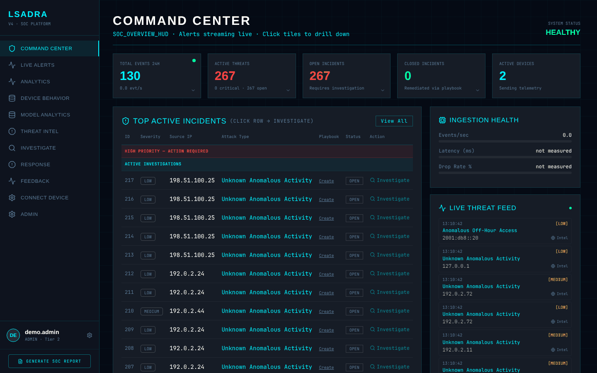
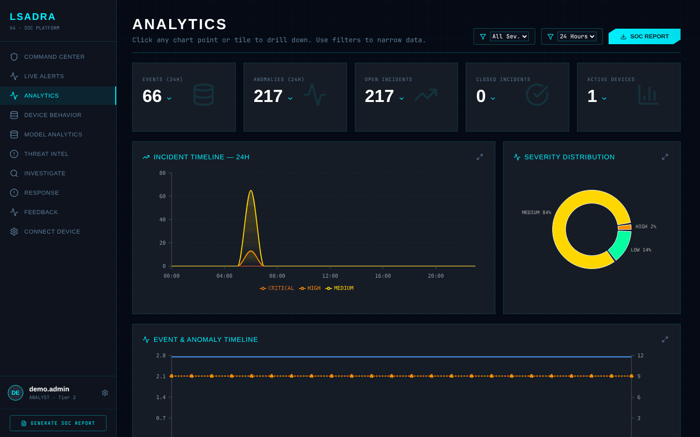
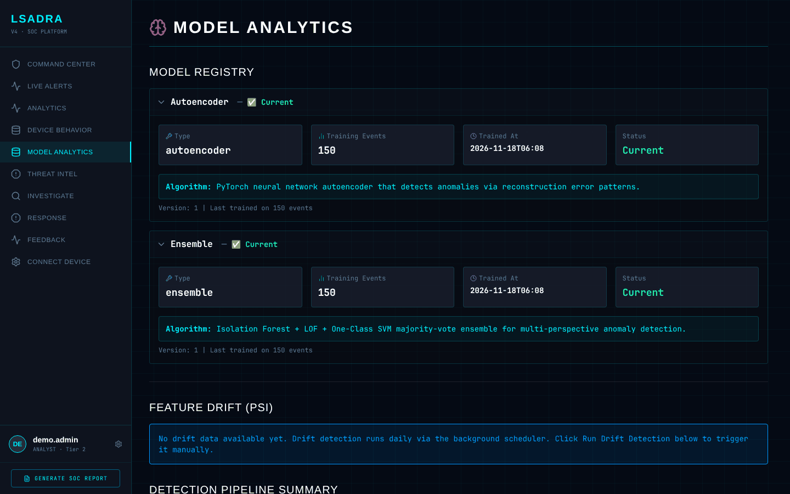
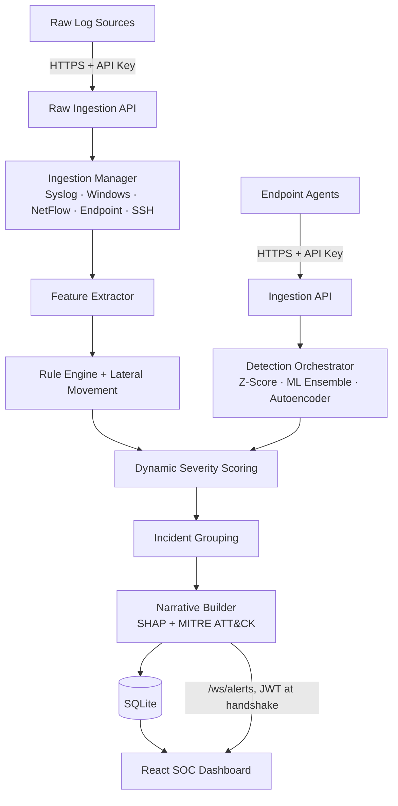

<div align="center">

# 🛡️ LSADRA

### Local Security Anomaly Detection & Risk Assessment: open source, explainable, built to run anywhere.

**Real-time, multi-source log detection with ML ensembles, SHAP explainability, and human-readable threat narratives. No LLM API keys required.**

<br/>

[](LICENSE)
[](https://www.python.org/)
[](https://fastapi.tiangolo.com/)
[](frontend/)
[](tests/test_v4_smoke.py)
[](tests/security/)
[](https://github.com/tsmanral/lsadra/actions/workflows/ci.yml)
[](https://github.com/tsmanral/lsadra/stargazers)

<br/>



<sub>The Command Center after replaying the bundled synthetic demo corpus. Every screenshot in this README is the real dashboard running against a local API.</sub>

</div>

---

## Contents

- [Why LSADRA?](#why-lsadra)
- [Quick start (local, about 10 minutes)](#quick-start-local-about-10-minutes)
- [Dashboard tour](#dashboard-tour)
- [Connect a real device](#connect-a-real-device)
- [Run with Docker](#run-with-docker)
- [Configuration](#configuration)
- [Testing](#testing)
- [Benchmarks](#benchmarks)
- [Ingesting logs](#ingesting-logs)
- [Live alert stream (WebSocket)](#live-alert-stream-websocket)
- [Architecture](#architecture)
- [Project structure](#project-structure)
- [Contributing](#contributing)
- [Security](#security)
- [Project status](#project-status)

## Why LSADRA?

Enterprise SIEMs like Splunk and Microsoft Sentinel are powerful, and they are also heavy, expensive and opaque. Lightweight consumer tools watch the network but have no real detection intelligence. **LSADRA fills the gap**: a self-hostable SOC platform for individuals and small teams that explains *why* every alert fired.

- 🧠 **Multi-layer ML detection.** Statistical baselining (Z-score), an ensemble (Isolation Forest, LOF, One-Class SVM), and a PyTorch autoencoder, with drift tracking via Population Stability Index.
- 🔍 **Explainable by design.** SHAP feature attribution, composite severity scoring with a plain-English breakdown per alert, and MITRE ATT&CK technique mapping with confidence scores.
- 🌐 **Multi-source ingestion.** Parsers for SSH auth logs, Syslog, Windows Events, network flows (NetFlow / firewall) and endpoint telemetry, through a structured-event API and a raw-log API.
- 📖 **Threat narratives without an LLM.** A template case-file generator turns correlated anomalies into readable incident stories. Zero API keys, zero recurring cost.
- 🚨 **Detection rules that matter.** Brute force, credential stuffing, port scans, exfiltration, LOLBin abuse, persistence and lateral movement, with tunable thresholds and an analyst feedback loop.
- 📊 **SOC dashboard.** A React (Vite + TypeScript) command center with live alerts over an authenticated WebSocket, analytics, entity investigation, device and model views, and JWT auth with roles. A legacy Streamlit interface is also included.

## Quick start (local, about 10 minutes)

This runs the API and the React dashboard on your own machine, then fills them with a labeled synthetic demo corpus so there is something to look at. Every command below was run end to end for this README.

### Prerequisites

| Tool | Version | Check |
| --- | --- | --- |
| Python | **3.12** (what CI uses; newer versions generally work) | `python3.12 --version`, or `py -0` on Windows |
| Node.js + npm | 20 or newer (22 is used for the screenshots) | `node -v` |
| Git | any recent | `git --version` |

### 1. Clone and install the backend

```bash
git clone https://github.com/tsmanral/lsadra.git
cd lsadra
python3.12 -m venv venv                        # Windows: py -3.12 -m venv venv
venv/bin/pip install -r requirements.txt      # Windows: venv\Scripts\pip install -r requirements.txt
```

`requirements.txt` pulls the CPU-only PyTorch build. It is the largest download (a few hundred MB). PyTorch is optional at runtime: if it is missing, the server still starts and the autoencoder layer becomes a no-op, while the statistical and ensemble layers keep working.

### 2. Start the API in dev mode

The server refuses to start without a JWT secret unless dev mode is on, and the browser dashboard is only allowed to call the API from origins listed in `LSADRA_CORS_ORIGINS`. For a local run, set both:

```bash
# Linux / macOS
LSADRA_DEV_MODE=true LSADRA_CORS_ORIGINS=http://localhost:5173 \
  venv/bin/python -m uvicorn server:app --host 127.0.0.1 --port 8000
```

```powershell
# Windows PowerShell
$env:LSADRA_DEV_MODE = "true"
$env:LSADRA_CORS_ORIGINS = "http://localhost:5173"
venv\Scripts\python -m uvicorn server:app --host 127.0.0.1 --port 8000
```

The database is created at `data/sentinel_v3.db` on first launch. Check it is up with `curl http://127.0.0.1:8000/api/health`. Interactive API docs are at http://127.0.0.1:8000/docs.

> **Dev mode is for your own machine only.** It uses a random JWT secret that changes on every restart (so you sign in again after a restart) and does not require TLS. See [Run with Docker](#run-with-docker) for a production setup.

### 3. Load the demo data

In a second terminal, from the repository root:

```bash
venv/bin/python scripts/seed_demo.py          # Windows: venv\Scripts\python scripts\seed_demo.py
```

This replays the 217 events in [`demo/corpus/`](demo/) through the real HTTP API, exactly like an agent would: it registers the user `demo.admin` (password `demo-only-not-a-secret`), enrolls a device, sends the events in batches and lets online detection run. It ends with `done — open the dashboard; alerts should be present.` All demo data is synthetic by construction: `demo-host-NN` hostnames, `*.demo` users and RFC 5737 / RFC 3849 documentation IP addresses.

### 4. Start the dashboard

In a third terminal:

```bash
cd frontend
npm ci
npm run dev
```

Open **http://localhost:5173** and sign in as `demo.admin` / `demo-only-not-a-secret` (the sign-in button is labelled **Initialize**). You can also create your own account with **Register**.

> The dashboard calls the API at `http://localhost:8000`, which is set in [`frontend/src/services/api.ts`](frontend/src/services/api.ts). If you run the API elsewhere, change it there and add the dashboard's origin to `LSADRA_CORS_ORIGINS`.

### 5. Check everything works

```bash
venv/bin/python tests/test_v4_smoke.py        # expected: 27/27 passed
```

## Dashboard tour

The screenshots below were taken from the quick start above: one demo device, 217 replayed events, 1440×900 window. Accounts created with **Register** get the `ANALYST` role; `ADMIN` sees every user's data, other roles see only their own.

### Sign in


Sign-in goes only through `POST /api/auth/login`; there is no offline login, so if the API is unreachable, sign-in fails.

### Command Center


The home screen. The tiles at the top count events in the last 24 hours, active threats, open and closed incidents, and devices currently sending. **Top Active Incidents** lists open incidents by recency with their severity, source IP and attack type. The **Live Threat Feed** on the right is pushed over the `/ws/alerts` WebSocket as detection stores each anomaly. If the socket drops, the page reconnects with backoff and polls every 5 seconds in the meantime.

### Live Alerts


A full-width stream of every alert with its MITRE technique, source IP, target device and the generated narrative that explains why it fired: the statistical deviation (σ), the ensemble score, and context such as off-hours activity or multiple usernames targeted. **Pause console** freezes the stream while you read.

### Analytics



Incident timeline by severity, severity distribution, and event and anomaly volume. The severity and time-range filters at the top apply to every chart, and **SOC Report** exports a PDF report.

### Device Behavior


Every enrolled device grouped by platform, with its status. Select devices and **Apply Filter** to scope the Command Center, Analytics and Live Alerts to just those devices.

### Model Analytics



The model registry: which detection models are trained, on how many events, and when. Further down are feature drift (PSI), which the scheduler computes daily and you can trigger by hand, and a summary of the detection pipeline.

### Connect Device


Generates a one-time registration token and the one-line Linux install command for it. See [Connect a real device](#connect-a-real-device).

### Sources


Per-source ingestion health: which log sources are active, events per second and latency, and the ingestion nodes (devices) behind them.

### Pages that still show placeholder data

Some screens are designed but not yet wired to the API. They render, but parts of what they show are fixed sample content rather than your data. They are good first contributions:

| Page | What is still placeholder |
| --- | --- |
| Incident drill-down (`/app/incident/:id`) and its playbook | The whole page: entity details, attack timeline and raw log are the same sample incident, whichever incident you open |
| Investigate | The API has no entity endpoint yet (`GET /api/entity/{id}` returns 404), so every search shows a generic profile with a fixed risk score of 42 |
| Threat Intel | The lookup box does not call the API yet, so it returns nothing; the server-side AbuseIPDB cache (`LSADRA_ABUSEIPDB_API_KEY`) is not shown here |
| Response | Playbook steps, the console and the response metrics |
| Feedback | The feedback history list starts with sample entries |
| Live Alerts header and footer | The ingestion rate, uptime and status line |
| Command Center "Ingestion Health" | Events/sec and latency are fixed values from `GET /api/dashboard/health` |
| Sources | The average latency tile |
| Analytics | The event and anomaly timeline spreads the 24-hour totals evenly across the hours, and with no data yet the charts show generated sample series |
| Device Behavior | "Last seen" shows `NaNh ago` |
| Admin | User management needs the `ADMIN` role, and registration only creates `ANALYST` accounts, so a fresh install has no admin yet |

One more thing to know while testing: the dashboard serves built-in sample data to an account named exactly `testuser`, so pick any other username when you want to see your own data.

## Connect a real device

**Linux.** Open **Connect Device**, click **Generate new token**, and run the command it shows on the host you want to monitor:

```bash
curl -s http://<your-server>:8000/static/installer_linux.sh | sudo bash -s -- --token <TOKEN> --server http://<your-server>:8000
```

The installer registers the device with the token, installs the Python agent as a systemd service, and picks `/var/log/auth.log` or `journalctl` automatically. Tokens are single-use. Use `https://` for anything beyond a lab: the agent sends its API key on every request.

**Windows (test agent).** `python windows_agent_simulator.py` starts a local API, registers a simulated Windows device and streams events from a dummy log file. `windows_live_agent.py` reads the live Windows event log.

**Anything else.** Send events straight to the [ingestion API](#ingesting-logs).

## Run with Docker

The Compose stack runs the API (`:8000`), the legacy Streamlit dashboard (`:8501`) and an idle agent simulator. The React dashboard is not part of the stack yet; run it as in the quick start, or build it with `cd frontend && npm ci && npm run build` and serve `frontend/dist` with any static file server.

```bash
cp .env.example .env
# Edit .env: set LSADRA_JWT_SECRET to a long random value, for example the output of
#   python -c "import secrets; print(secrets.token_urlsafe(32))"
docker compose -f docker-compose.yml up -d --build
```

Name `docker-compose.yml` explicitly as above. A plain `docker compose up` also loads [`docker-compose.override.yml`](docker-compose.override.yml), the development override: it mounts the source tree, turns on hot reload and forces TLS off.

`.env.example` sets `LSADRA_REQUIRE_TLS=false` so a first run works over plain HTTP. For a real deployment, put the API behind HTTPS, set `LSADRA_REQUIRE_TLS=true`, and list your proxy in `LSADRA_TRUSTED_PROXY_IPS`. A versioned image is published to [GHCR](https://github.com/tsmanral/lsadra/pkgs/container/lsadra) on every release.

## Configuration

All settings are environment variables; [`.env.example`](.env.example) lists every one with a comment. The server reads them from the process environment and does not load `.env` itself (Docker Compose does). The ones you are most likely to need:

| Variable | Default | What it does |
| --- | --- | --- |
| `LSADRA_DEV_MODE` | `false` | Local development only: per-boot JWT secret, TLS optional |
| `LSADRA_JWT_SECRET` | none | Required outside dev mode; the server will not start without it |
| `LSADRA_CORS_ORIGINS` | empty | Comma-separated browser origins allowed to call the API, e.g. `http://localhost:5173` |
| `LSADRA_REQUIRE_TLS` | `true` (`false` in dev mode) | Reject plain-HTTP requests |
| `LSADRA_TRUSTED_PROXY_IPS` | empty | Reverse proxies whose `X-Forwarded-Proto` is trusted |
| `LSADRA_ABUSEIPDB_API_KEY` | empty | Enables IP reputation lookups on Threat Intel |
| `LSADRA_GEO_RESOLUTION_ENABLED` | `false` | Opt-in IP geolocation (sends observed public IPs to ipinfo.io) |
| `LSADRA_RETENTION_DAYS` | `30` | How long events are kept |
| `LSADRA_SCHEDULER_ENABLED` | `true` | Background jobs: retention, metrics, correlation, drift, device health |
| `LSADRA_MIN_BASELINE_EVENTS` | `200` | Events a device needs before its baseline is trusted |

## Testing

CI runs these on every pull request across Ubuntu, Windows and macOS. Run them before you open one. CI sets `LSADRA_DEV_MODE=true` for the test steps, and so should you if the shell has no `LSADRA_JWT_SECRET`.

| What | Command | Expected | Time |
| --- | --- | --- | --- |
| Smoke gate | `python tests/test_v4_smoke.py` | `27/27 passed` | seconds |
| Security regression gate | `python -m pytest tests/security/ -q` | `492 passed` | ~10 s |
| Full backend suite | `python -m pytest tests/ --ignore=tests/test_v4_smoke.py -q` | `922 passed` | ~1 min |
| Lint | `ruff check .` (install with `pip install ruff`) | `All checks passed!` | seconds |
| Dashboard type check + build | `cd frontend && npm ci && npm run build` | `✓ built` | ~1 min |
| Dashboard lint | `cd frontend && npm run lint` | CI fails only if errors exceed the recorded baseline | seconds |

Use the `python` from your virtual environment (`venv/bin/python`, or `venv\Scripts\python` on Windows). Tests use their own temporary databases and never touch `data/`.

## Benchmarks

[`benchmarks/`](benchmarks/) drives the real API at rising event rates and records sustained events/s, request latency percentiles, event-loop lag and memory. Each run gets a fresh temporary database and model store.

```bash
# 30-second sanity check
python benchmarks/run_ingest_bench.py --detection off --devices 1 --rates 50 \
    --duration 5 --min-requests 1 --repeats 1 --output /tmp/check.json

# Full baseline, about 25 minutes; run on an otherwise idle machine
python benchmarks/run_ingest_bench.py
```

The sanity check prints a line such as `devices=1 offered=50 sustained=50 p50/p95/p99=29.71/42.27/43.38ms` and writes the full result as JSON. Method, committed baselines and how to compare runs are in [`benchmarks/README.md`](benchmarks/README.md). `scripts/seed_demo.py --rate 500 --duration 30 --devices 10` is the same load driver on its own, against a server you started.

## Ingesting logs

Both ingestion endpoints authenticate the device with `X-Device-Id` / `X-Api-Key` (issued at device registration) and accept up to 100 items per request.

**Structured events.** Collectors that already normalize send events that conform to the frozen [event schema v1](docs/contracts/event-schema.v1.json):

```bash
curl -X POST http://localhost:8000/api/events/batch \
  -H "Content-Type: application/json" \
  -H "X-Device-Id: <device-id>" -H "X-Api-Key: <api-key>" \
  -d '{"events": [{"schema_version": "1", "timestamp": "2026-01-15T02:01:12Z", "event_type": "auth_failure",
                   "host": "demo-host-01", "effective_username": "alice.demo", "source_ip": "192.0.2.45"}]}'
```

`schema_version` (`"1"`), `timestamp` (RFC 3339 with offset) and `event_type` are required. Device and user identity come from the credentials, so `device_id`/`user_id` in an event, or any unknown field, are rejected. A contract violation returns `422` naming the field (e.g. `["body", "events", 0, "source_ip"]`) and nothing from that batch is stored. Full rules and the compatibility policy: [docs/contracts](docs/contracts/README.md).

**Raw lines.** Any log line from any supported source, parsed server-side:

```bash
curl -X POST http://localhost:8000/api/events/raw \
  -H "Content-Type: application/json" \
  -H "X-Device-Id: <device-id>" -H "X-Api-Key: <api-key>" \
  -d '{"lines": [{"raw_line": "Jan  5 12:34:56 demo-host-01 sudo[999]: root : COMMAND=/bin/bash", "source_hint": "syslog"}]}'
```

`source_hint` is optional and must be one of `ssh`, `syslog`, `windows`, `network`, `endpoint`; omit it to auto-detect. Lines no parser recognizes are counted in `parse_errors` rather than rejected.

Per-source ingestion health is available at `GET /api/events/stats`.

## Live alert stream (WebSocket)

`/ws/alerts` is a WebSocket that pushes each anomaly to connected clients as soon as detection persists it. It authenticates at the handshake with the same JWT the dashboard uses for REST (`POST /api/auth/login`), and nothing is accepted before the token verifies. Browsers pass the token as a subprotocol; other clients can send an `Authorization: Bearer` header instead. Tokens in the query string are not read.

```js
const ws = new WebSocket("wss://lsadra.example/ws/alerts", ["bearer", token]);
ws.onmessage = (e) => console.log(JSON.parse(e.data)); // {"type":"ready",...} then {"type":"alert",...}
```

Scoping matches the REST API: an ADMIN receives every alert, other roles only their own. A missing, invalid or expired token, or plain `ws://` while TLS is required, is refused with close code `1008` (an HTTP `403` at the handshake). An open socket is closed with `1008` when its token expires, so the client reconnects with a fresh one. A client that stops reading is closed with `1013` once `LSADRA_WS_ALERT_QUEUE_SIZE` alerts (default 256) are waiting for it; it should reconnect and backfill from `GET /api/dashboard/anomalies`. The dashboard's Command Center and Live Alerts pages load recent alerts over REST, then add each pushed alert as it arrives. After any disconnect they reconnect with backoff (1 s doubling to 30 s) and backfill over REST, and while the socket is down the Command Center falls back to polling every 5 s. Incidents, KPIs and ingestion health still refresh over REST, every 10 s and shortly after each new alert.

## Architecture



A deeper technical walkthrough lives in [ARCHITECTURE.md](ARCHITECTURE.md), and the platform's design evolution is documented in [docs/V3_VS_V4_EVOLUTION.md](docs/V3_VS_V4_EVOLUTION.md).

Ingestion never runs detection inside the request: the handler stores the batch and enqueues the device on a bounded, per-device-coalescing queue drained by a single detection worker on its own thread (`LSADRA_DETECTION_QUEUE_SIZE`, default 256 devices; when it is full, ingestion answers `503` with `Retry-After` and stores nothing, so agent retries never duplicate events). API handlers never wait on SQLite or bcrypt on the event loop either: each one runs its storage and hashing work in the server's thread pool, so a slow write cannot stall other requests. A device key that has passed bcrypt is not re-hashed on every batch: a short-lived, size-bounded cache remembers the verification (as a keyed fingerprint, never the key) for `LSADRA_DEVICE_AUTH_CACHE_TTL_SECONDS`, default 60 s, bound to the stored hash, so re-keying or deleting a device still takes effect on the next request. Once an entry is past half its TTL, the next batch from that device queues a background bcrypt re-verify that renews it, so a device that sends steadily never waits on bcrypt after its first batch. Detection itself is CPU-bound Python on that worker thread, so the server shortens Python's thread switch interval at startup (`LSADRA_THREAD_SWITCH_INTERVAL_MS`, default 0.5 ms, against CPython's 5 ms), so a detection run hands the GIL back to waiting ingestion requests sooner.

Background jobs (APScheduler) handle cross-source correlation, lateral-movement scans, metrics pre-aggregation, geo-resolution, threat-intel caching, drift detection and data retention. No external queue or cron is required.

**Today** the stack is Python end to end: a FastAPI core (ingestion, detection, storage, orchestration), a React + Vite SOC dashboard, and a thin Python endpoint agent.

**Planned:** the endpoint agent is being replaced by **Rust collectors**, small static binaries (target: <15 MB RSS) that read the OS log source, batch, and ship over HTTPS with disk spooling across outages. The Python core keeps the ML and explainability work, where its ecosystem is the reason to stay. The two sides are bound by a versioned contract, [`docs/contracts/event-schema.v1.json`](docs/contracts/event-schema.v1.json), rather than shared code. See [ADR 0001](docs/architecture/adr/0001-rust-collector-split.md) for the reasoning.

## Project structure

```
lsadra/             Core platform: auth, ingestion, detection, storage, scheduler, legacy UI
frontend/           React (Vite + TypeScript) SOC dashboard
tests/              Test suite + end-to-end smoke tests
  security/         Security regression suite, one file per remediated finding
  storage/          Storage contract suite: every public storage function, on the real migrations
demo/               Labeled synthetic demo corpus (JSONL) + scenario documentation
  corpus/           ssh_bruteforce · persistence_new_service · data_movement_offhours · benign_background · injection_attempts
scripts/            Operator tooling (seed_demo.py replays the demo corpus through the real API; --rate/--devices load mode)
benchmarks/         Ingest benchmark harness + committed baseline results (see benchmarks/README.md)
docs/               Documentation tree
  architecture/adr/ Architecture Decision Records
  contracts/        event-schema.v1.json, the versioned collector ↔ core event contract
  screenshots/      Dashboard screenshots used in this README
  threat-models/    Threat models (product, agent-key custody, prompt injection)
datasets/           Synthetic SSH log generator for local experimentation
.github/workflows/  CI matrix, DCO, release, security scanning, label sync, Discord notifications
.github/ISSUE_TEMPLATE/  Bug and feature issue forms; security reports are routed to private reporting
.github/labels.json Issue labels (good first issue, area: *, needs-triage), synced by the labels workflow
fleet_simulator.py  Multi-device fleet traffic simulator
windows_agent_simulator.py  All-in-one Windows test agent
windows_live_agent.py       Live Windows event agent
server.py           FastAPI entry point
CLAUDE.md           Rules for AI coding agents working in this repo
```

## Contributing

Contributions are welcome. Read the [Contributing Guide](CONTRIBUTING.md) for the development setup, coding standards and pull-request process. The short version:

1. **Fork** the repo and create a feature branch from `main` (`git checkout -b feature/my-improvement`).
2. Get the app running with the [quick start](#quick-start-local-about-10-minutes), make your change, and run the [tests](#testing). At minimum:
   ```bash
   python tests/test_v4_smoke.py          # expect 27/27
   python -m pytest tests/security/ -q    # expect 0 failures
   ruff check .
   ```
3. Sign off your commits (`git commit -s`). This project uses the [DCO](https://developercertificate.org/) rather than a CLA, and it is enforced: the DCO check is a required status check, so an unsigned commit blocks the merge. See [CONTRIBUTING.md](CONTRIBUTING.md#sign-off-dco).
4. Open a **pull request** against `main` with a clear description. Use Conventional Commit subjects (`feat:`, `fix:`, `docs:`, ...).

`main` is protected and the only long-lived branch: **everything lands through a pull request**, including maintainer work. Every PR runs the full CI matrix (Ubuntu, Windows, macOS), a lint pass, secret scanning and the DCO check.

**Where to start.** Issues labelled [`good first issue`](https://github.com/tsmanral/lsadra/labels/good%20first%20issue) are scoped for newcomers. The [pages that still show placeholder data](#pages-that-still-show-placeholder-data) are another good entry point: each one is a self-contained frontend + API task you can see working in the dashboard. Bug reports and feature ideas go in [Issues](https://github.com/tsmanral/lsadra/issues) through the bug and feature forms.

Changes to user-facing behavior, environment variables, endpoints or project structure must update this README **in the same PR**; the PR template has a checkbox for it. If a change alters what a dashboard page looks like, refresh its screenshot in [`docs/screenshots/`](docs/screenshots/) by following the quick start (1440×900 window, demo data loaded).

This project follows the [Contributor Covenant Code of Conduct](CODE_OF_CONDUCT.md).

## Security

LSADRA treats logs as **attacker-controlled input**: they reach parsers, the detection pipeline, and (later) an LLM and a RAG index. The threat model is written down in [`docs/threat-models/`](docs/threat-models/).

- **Reporting a vulnerability:** use [private vulnerability reporting](https://github.com/tsmanral/lsadra/security/advisories/new) on this repo, or follow the [Security Policy](SECURITY.md). **Never open a public issue for a security finding.** Acknowledgement within 72 hours, triage within 7 days.
- **Regression suite:** every remediated finding is pinned by tests in [`tests/security/`](tests/security/), 492 tests run on every PR across all three platforms. A fix without a regression test is not considered done.
- **Supply chain:** every GitHub Action is pinned to a commit SHA, secret scanning runs on every PR diff plus a weekly full-history scan, Dependabot covers pip, npm and Actions, and release artifacts will be signed from M5 onward.

## License

Distributed under the **GNU Affero General Public License v3.0**. See [LICENSE](LICENSE) for details.

## Project status

[](https://github.com/tsmanral/lsadra/releases)
[](https://github.com/tsmanral/lsadra/commits/main)
[](https://github.com/tsmanral/lsadra/graphs/commit-activity)
[](https://github.com/tsmanral/lsadra/issues)
[](https://github.com/tsmanral/lsadra)
[](https://github.com/tsmanral/lsadra/pkgs/container/lsadra)

**Current release: v5.0.0.** Active development. This section is kept current: if it disagrees with the code, the code is right and the README is a bug.

**Where the project is now**

- **Security remediation complete.** Every finding from two rounds of automated security review is fixed and pinned by regression tests in [`tests/security/`](tests/security/). One item remains deferred by design: signed agent distribution (lands with release engineering). The `/ws/alerts` live feed authenticates at the handshake (see [Live alerts](#live-alert-stream-websocket)).
- **CI on every PR:** the smoke, security-regression and full backend suites across Ubuntu, Windows and macOS; a frontend job that type-checks and builds the dashboard and holds ESLint errors at or below the recorded baseline; plus lint, secret scanning and a DCO check. A weekly job re-scans full history for secrets.
- **PR-only workflow.** `main` is protected; all work, maintainer included, lands through pull requests.
- **Distribution:** GitHub Releases and a container image at `ghcr.io/tsmanral/lsadra`.
- **Demo mode:** a labeled synthetic corpus in [`demo/`](demo/) plus [`scripts/seed_demo.py`](scripts/seed_demo.py), which replays it through the real ingestion API so a fresh install has something to look at. `--rate/--duration/--devices` turn the same script into a fixed-rate load driver.
- **Event schema v1 frozen and enforced.** [`docs/contracts/event-schema.v1.json`](docs/contracts/event-schema.v1.json) is the collector ↔ core contract; `POST /api/events/batch` rejects any event that violates it with a `422` naming the field, and a contract test keeps the core's model and the schema from drifting ([ADR 0006](docs/architecture/adr/0006-event-schema-v1-freeze.md)).
- **Ingest performance:** device-credential caching, off-loop storage and a background detection worker keep ingestion p99 latency under 250 ms at 1,000 events/s in the [benchmark](#benchmarks); committed results are in [`benchmarks/`](benchmarks/).

**What's next (M1, async core)**

- Async ingestion on aiosqlite + WAL with worker queues, retention lifecycle, and DuckDB analytics
- Prompt-injection defense: logs are attacker-controlled input, and they reach the LLM and RAG index

Follow [Releases](https://github.com/tsmanral/lsadra/releases) for progress, or the [ADRs](docs/architecture/adr/) for the reasoning behind the larger calls.

## Author

**Tribhuwan Singh**

[](https://github.com/tsmanral)
[](https://www.linkedin.com/in/singhtribh/)
[](https://tsmanral.github.io/)
[](mailto:tribhuwan.singh1108@gmail.com)

## Contributors

Thanks to everyone who has contributed to LSADRA:

<a href="https://github.com/tsmanral/lsadra/graphs/contributors">
  
</a>

---

<div align="center">
⭐ If LSADRA is useful to you, consider starring the repo. It helps the project reach more people.
</div>
