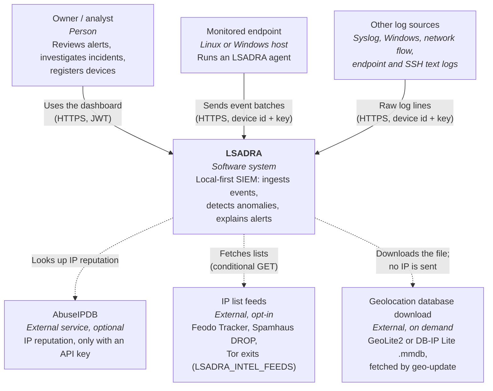
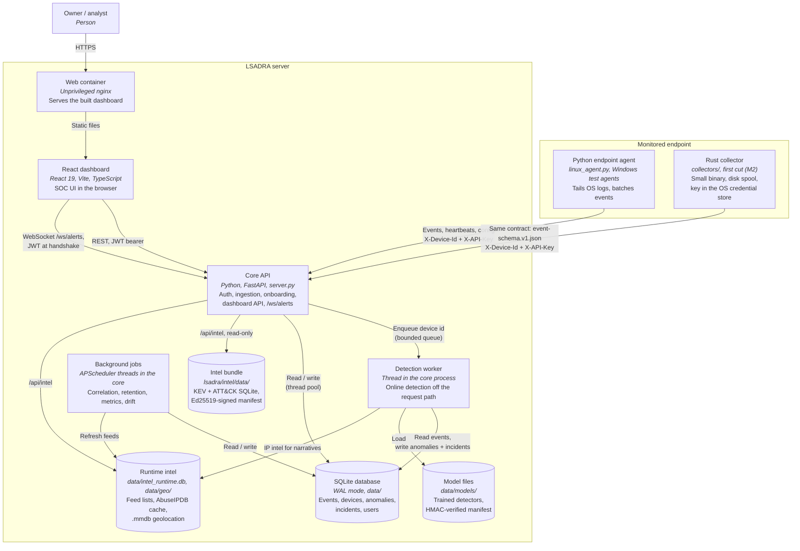
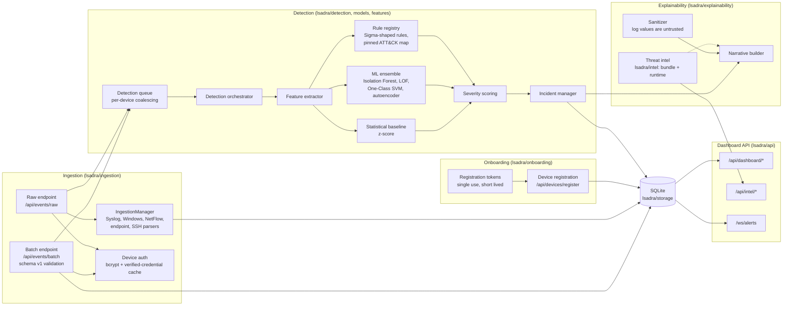
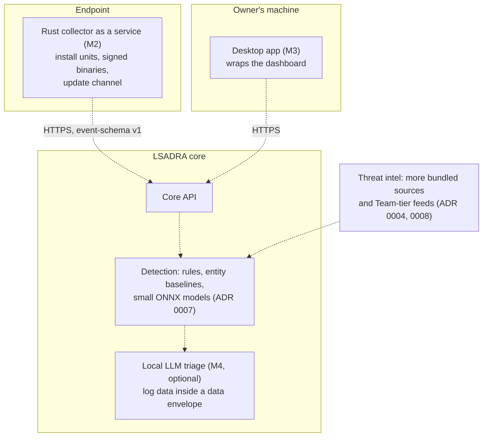

# C4 diagrams

These diagrams follow the [C4 model](https://c4model.com/): system context,
containers, then the components inside the Python core. They describe what is
on `main` today. Planned pieces are drawn with dashed lines and labelled with
the milestone that brings them.

The diagrams are Mermaid flowcharts, so they render both on GitHub and in the
docs site. When a change moves a box or an arrow, update the diagram in the
same pull request.

## Level 1: System context

Who uses LSADRA and what it talks to.

LSADRA runs on hardware the owner controls. Core detection, narratives and the
bundled threat intel (CISA KEV, MITRE ATT&CK, signed and shipped in the package)
need no cloud service. IP geolocation reads a local `.mmdb` file, so no IP leaves
the machine for it. The feeds and AbuseIPDB are off unless the owner turns them
on, so a fresh install makes no intel requests.

## Level 2: Containers

The deployable and runnable pieces, and how they talk.

Notes:

- The core is one Python process, started with `python -m lsadra.serve`. It
  listens on loopback by default and refuses plain HTTP on any other address.
  The detection worker and the background jobs
  are threads inside it, not separate services, so there is no external queue
  or cron to run.
- The agent to core boundary is the versioned event contract,
  [`event-schema.v1.json`](../contracts/event-schema.v1.json)
  ([ADR 0001](adr/0001-rust-collector-split.md),
  [ADR 0006](adr/0006-event-schema-v1-freeze.md)). The Rust collectors in
  `collectors/` (journald and Windows Event Log sources so far) follow the same
  contract, checked in their CI, and replace the Python agent at M2 without
  changing the core. They are not in releases yet.
- The React dashboard is the supported UI. With Docker Compose it is built and
  served by the `web` container (port 8080); in development it runs on the Vite
  dev server, and the desktop app shows it in a native window. The old
  Streamlit dashboard has been removed.

## Level 3: Components of the core

What happens to an event inside the core API and the detection worker.

The ingestion handler only stores the batch and enqueues the device. When the
queue is full it answers `503` with `Retry-After` and stores nothing, so an
agent retry never duplicates events. Detection, model scoring and narrative
building all run on the detection worker thread.

## Target state

The pieces the roadmap adds, drawn against today's containers. Nothing in this
section exists on `main` yet.

The milestones and the order of work live in the project roadmap. Decisions
that shape this picture are recorded as ADRs in [adr/](adr/README.md).
