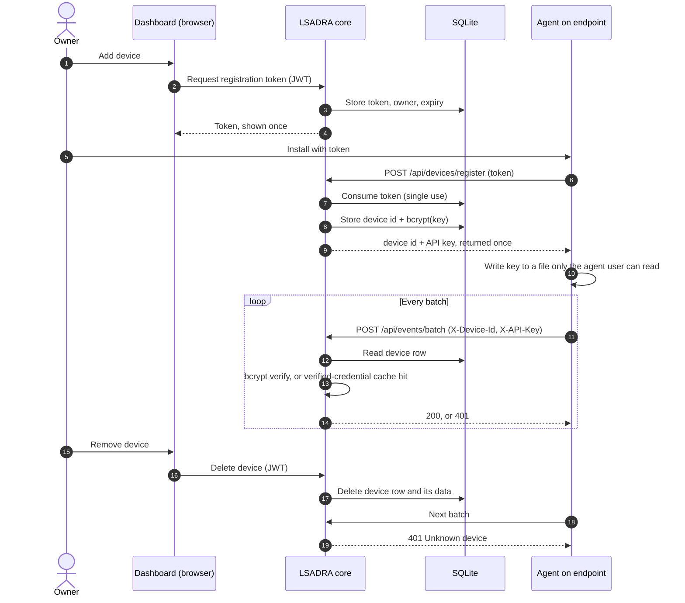

# Threat model: agent-key custody

How an endpoint agent gets its credential, where the credential lives, how the
core checks it, and how it stops working. Written STRIDE-style against `main`.

> Threat models describe defenses and trust boundaries only. Specific unfixed
> vulnerabilities are tracked privately, never in committed docs. Report one
> through [private vulnerability reporting](https://github.com/tsmanral/lsadra/security/advisories/new).

## Scope

In scope: registration tokens, device API keys, their storage on the endpoint
and in the core, their use on the ingestion endpoints, and removal of a device.

Out of scope: analyst logins and JWTs (covered by the product threat model),
and transport configuration of the reverse proxy in front of the core. Agent
file integrity is covered here only as far as the install command's hash
checks; signed agent packages are planned with release engineering (M5).

## Assets

| Asset | Why it matters |
|---|---|
| Registration token | Turns into a device credential for the owner who created it |
| Device API key | Lets its holder write events as that device |
| Stored key hash | Lets an attacker who also has the database try to recover keys offline |
| Event stream of a device | What detection and incidents are built from; forged or suppressed events hide attacks |

## Actors

- **Owner / analyst**: signed in to the dashboard, creates registration tokens
  and removes devices.
- **Agent**: runs on the monitored host with read access to OS logs.
- **Local attacker on a monitored host**: wants to read the key, or to stop or
  spoof the agent.
- **Network attacker**: sits between agent and core.
- **Remote attacker with no credential**: can reach the core's public endpoints.

## Lifecycle and trust boundaries

Trust boundaries crossed:

1. **Browser to core**: token creation and device removal require a signed-in
   user.
2. **Endpoint to core**: registration and every batch cross the network. The
   core treats everything an agent sends, including the event payload, as
   untrusted input.
3. **Agent process to the rest of the host**: the key file sits on a machine
   the core does not control.

## Controls in place

| Control | Where |
|---|---|
| Only admins and analysts can create registration tokens | `lsadra/ui/api_dashboard.py` |
| Registration tokens are random (`secrets.token_urlsafe`), single use and expire after `REGISTRATION_TOKEN_LIFETIME_MINUTES` (15 min) | `lsadra/onboarding/token_manager.py`, `lsadra/config.py` |
| Token consumption is serialized, so one token can never register two devices | `lsadra/onboarding/device_registration.py` |
| Registration is rate limited per client IP, with a bounded tracker so spoofed sources cannot grow memory | `lsadra/onboarding/device_registration.py`, `lsadra/ratelimit.py` |
| Device ids are random UUIDs; keys are 256-bit random values generated by the core | `lsadra/onboarding/device_registration.py` |
| The core stores only a bcrypt hash of each key; the plain key is returned once | `lsadra/onboarding/device_registration.py` |
| Key checks fail closed: any bcrypt error (for example an over-long key) is a `401`, never a `500` or a pass | `lsadra/ingestion/api_ingestion.py` |
| The verified-credential cache stores an HMAC fingerprint, never the key, bound to the stored hash, so re-keying or removing a device takes effect on the next request | `lsadra/ingestion/credential_cache.py` |
| The cache is bounded in size and lifetime (`LSADRA_DEVICE_AUTH_CACHE_MAX_ENTRIES`, `LSADRA_DEVICE_AUTH_CACHE_TTL_SECONDS`, at most 1 h) | `lsadra/config.py` |
| Keys are never logged; failed checks log the device id only | `lsadra/ingestion/api_ingestion.py` |
| Every event must match event schema v1, so a valid key cannot push arbitrary structures into storage | `docs/contracts/event-schema.v1.json`, [ADR 0006](../architecture/adr/0006-event-schema-v1-freeze.md) |
| The install command checks the installer's SHA-256 before it runs, and the installer refuses an agent file whose SHA-256 differs from the one the dashboard showed | `lsadra/onboarding/agent_files.py`, `lsadra/onboarding/installer_linux.sh` |
| The installer refuses a plain-HTTP server unless `--allow-insecure-http` is passed for a local lab, so the key is not sent in clear by default | `lsadra/onboarding/installer_linux.sh` |
| The Linux installer writes the key to `/etc/lsadra-agent/config.yml` with mode `600`, owned by the agent's service user | `lsadra/onboarding/installer_linux.sh` |
| Outside development mode, TLS enforcement is on by default | `lsadra/config.py`, `lsadra/tls_middleware.py` |
| Security fixes ship with a regression test | `tests/security/` |

## STRIDE

| Threat | Example | Mitigations | Residual risk |
|---|---|---|---|
| **Spoofing** | Someone sends events as a device they do not own | Per-device random key, bcrypt-verified; registration needs an owner-issued, single-use, short-lived token | Whoever holds a device's key can send as that device until it is removed |
| **Tampering** | Forged events written into a device's history | Key check on every batch; schema v1 validation; storage writes only after both pass | Events from a compromised host are authentic from the core's point of view; detection has to judge them |
| **Repudiation** | A device denies having sent a batch | Every stored event carries the authenticated device id | Analyst actions on devices (token creation, removal) belong to the product threat model |
| **Information disclosure** | Key read from the host, the wire or the database | File mode `600` on Linux; TLS by default outside dev mode; only bcrypt hashes in the database; keys never logged | Root or Administrator on the endpoint can read the key; that is accepted until OS-keychain storage lands |
| **Denial of service** | Flooding registration or ingestion; forcing bcrypt on every request | Registration rate limit; bounded detection queue answering `503` + `Retry-After`; credential cache keeps bcrypt off the hot path | Large floods are expected to be absorbed by the reverse proxy or firewall in front of the core |
| **Elevation of privilege** | A device key used to reach analyst or admin APIs | Device keys are accepted only by the device endpoints (ingestion, heartbeat, device config), and a heartbeat must name the device its key belongs to; dashboard APIs require a JWT with a role | None known |

## Planned controls

| Control | Milestone |
|---|---|
| Rust collectors keep the key in the OS credential store instead of a config file | M2 |
| Key rotation: the agent obtains a new key and the old one stops working after a short overlap | M2 |
| Revoke a device without deleting its event history | M2 |
| Signed agent packages and installers | M5 |

## When to update this page

Update it in the same pull request as any change to registration tokens,
device keys, device removal, agent storage of credentials, or the ingestion
authentication path.
