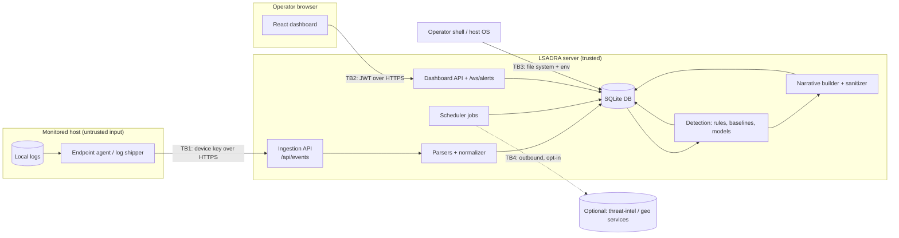

# Product threat model (STRIDE)

One page covering LSADRA's trust boundaries, the threats at each boundary, and
the controls that answer them. It is reviewed before each release (see
[release security review](../security/release-security-review.md)) and whenever
a change adds a new boundary, a new input, or a new privileged action.

> This page describes defenses and target controls only. Specific unfixed
> weaknesses are tracked privately through the process in
> [SECURITY.md](../../SECURITY.md) and never listed here.

## Scope and assets

| Asset | Why it matters |
|---|---|
| Raw log events (`normalized_events`) | May hold usernames, IP addresses, hostnames and command lines from monitored hosts |
| Alerts, incidents and analyst feedback | Reveal what the operator knows about attacks in progress |
| Server signing secret (`LSADRA_JWT_SECRET`) | Anyone holding it can mint dashboard sessions for any role |
| Device API keys | Let a host write events as a registered device |
| Detection models (`data/models/`) | Loaded into the server process; a swapped model can blind detection |
| The SQLite database file | Holds all of the above at rest |

## Data flow

Trust boundaries:

- **TB1, agent to server.** Everything a host sends is attacker-controlled: a
  compromised host can send any bytes it likes.
- **TB2, browser to server.** Operators authenticate with a signed session
  token. The target is that every route checks role and, where data belongs to
  a user, ownership.
- **TB3, host OS to server.** Whoever controls the server's file system or
  environment controls secrets, models and the database.
- **TB4, server to the internet.** Off by default. Enrichment calls are opt-in
  and never sit on the detection path.

## Threats and controls

| Boundary | STRIDE | Threat | Control |
|---|---|---|---|
| TB1 | Spoofing | A host sends events as another device | Per-device API key, stored only as a bcrypt hash; ingest requests must present a matching device ID and key |
| TB1 | Tampering | Crafted log lines break or mislead a parser | Parsers treat input as untrusted text; property-based fuzz tests in `tests/fuzz/` assert every parser returns a well-formed event or rejects the line, never crashes |
| TB1 | Tampering | Log text injects markup or instructions into narratives (R8) | `explainability/sanitize.py::clean_field` on every log-derived value; see the R8 section in [README](README.md) |
| TB1 | Denial of service | A host floods the ingest API | Per-device sliding-window rate limit with a bounded key table; bounded detection queue |
| TB1 | Repudiation | A device denies sending an event | Every stored event carries the authenticated device ID and server receive time |
| TB2 | Spoofing | Forged or replayed session tokens | HS256 tokens signed with the server secret and an expiry (`LSADRA_JWT_EXPIRATION_MINUTES`); a secret must be set outside dev mode |
| TB2 | Elevation of privilege | A lower role calls an admin action | Role checks on privileged routes, with regression tests under `tests/security/` |
| TB2 | Information disclosure | One user reads another user's devices, alerts or exports | Ownership filter on user-scoped queries; IDOR regression tests |
| TB2 | Tampering | Cross-site requests from another origin | CORS allow-list is empty unless configured; tokens travel in headers, not cookies |
| TB2 | Information disclosure | Live alert stream read without login | `/ws/alerts` requires a valid token before the socket is accepted |
| TB3 | Information disclosure | Database file copied off the server | Keep the data directory readable only by the service user; full-disk encryption is the baseline at rest |
| TB3 | Tampering | Model files swapped to blind detection | Models load only from the server's own data directory; integrity checks are a tracked hardening item |
| TB3 | Information disclosure | Signing secret leaked through logs or images | Secret read from the environment only; secret scanning (gitleaks on PRs, weekly TruffleHog) on the repository |
| TB4 | Information disclosure | Enrichment calls leak observed IPs to a third party | Geolocation and threat-intel lookups are opt-in and cached |
| All | Repudiation | Operator actions cannot be reconstructed | Structured server logs today; a hash-chained audit trail is planned |

## Data retention

Raw events and heartbeats expire after `LSADRA_RETENTION_DAYS` (default 30).
Alerts and their rollups expire after `LSADRA_ALERT_RETENTION_DAYS` (default
365), so a slow-burning intrusion found months later still has its alert
history. Events that an alert still references stay until that alert expires.

## Review triggers

Update this page in the same PR when a change:

- adds an HTTP route, socket, file reader or outbound call;
- adds a role, a privileged action, or anything that acts on a monitored host;
- changes how secrets, keys or models are stored or loaded.
